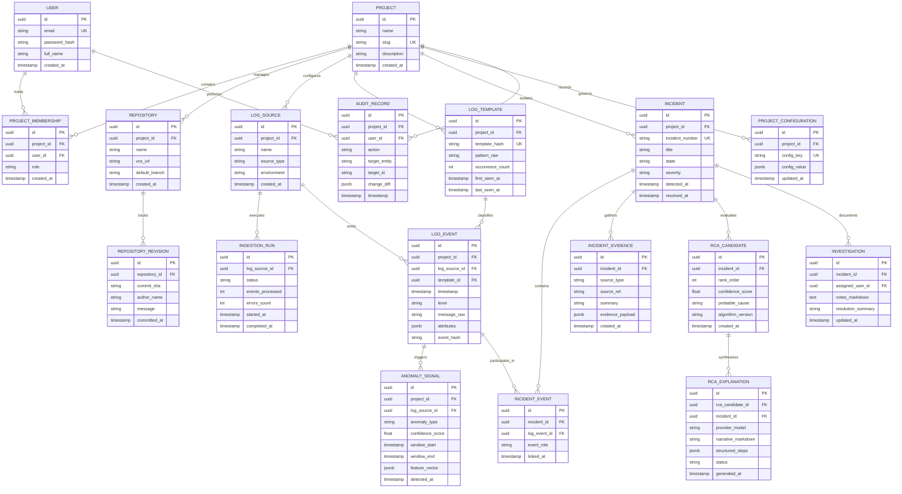

# LogPilot — Database & Domain Model

**Document ID:** D05  
**Status:** Draft for Architecture Review  
**Parent Documents:** [D01 — Product Requirements Document](file:///docs/requirements/PRD.md), [D02 — V1 Scope & Acceptance Criteria](file:///docs/requirements/V1_SCOPE.md), [D03 — System Architecture Document](file:///docs/architecture/SYSTEM_ARCHITECTURE.md), [D04 — Repository Architecture Document](file:///docs/architecture/REPOSITORY_ARCHITECTURE.md)  
**Project:** LogPilot: An Intelligent Observability and Root Cause Analysis Platform  

---

## 1. Objective & Scope

The purpose of this document is to define the **V1 Domain Model and Conceptual PostgreSQL Data Model** for LogPilot.

This model provides the structural foundation for the core product investigation lifecycle:

$$\text{Project} \longrightarrow \text{Log Sources} \longrightarrow \text{Normalized Events} \longrightarrow \text{Anomaly Signals} \longrightarrow \text{Incident} \longrightarrow \text{Evidence} \longrightarrow \text{RCA Candidates} \longrightarrow \text{Explanation}$$

Additionally, this document specifies:
- The domain boundaries across identity, projects, repositories, runtime logs, incidents, investigations, configuration, and auditability.
- Multi-tenant project isolation and data integrity invariants enforced at the persistence layer.
- Provenance tracking mechanisms that link root-cause hypotheses directly back to immutable source evidence (log events, Git diffs, and repository source-code chunks).
- Clear mapping of transient infrastructure (Redis) and vector retrieval indexes (Qdrant) back to PostgreSQL as the single source of truth.

This document represents the conceptual database design. Detailed API endpoint schemas are deferred to [D06](file:///docs/api/API_CONTRACTS.md), canonical log payload definitions to [D07](file:///docs/architecture/EVENT_LOG_SCHEMA.md), and physical migration DDL scripts to the implementation phase.

---

## 2. Data Ownership — Frozen Architectural Decisions

LogPilot enforces strict, non-overlapping ownership boundaries across its storage infrastructure as ratified in [D03](file:///docs/architecture/SYSTEM_ARCHITECTURE.md) and [ADR-005](file:///docs/adr/adr-005-storage-architecture.md):

```
┌─────────────────────────────────────────────────────────────────────────────┐
│                          STORAGE OWNERSHIP MATRIX                           │
├──────────────────────┬──────────────────────┬───────────────────────────────┤
│ PostgreSQL           │ Qdrant               │ Redis                         │
│ (System of Record)   │ (Retrieval Index)    │ (Infrastructure / Ephemeral)  │
├──────────────────────┼──────────────────────┼───────────────────────────────┤
│ • Projects & Users   │ • Code Embeddings    │ • Celery/Queue Task Lists     │
│ • Project Memberships│ • Diff Embeddings    │ • Dead-Letter Queues (DLQ)    │
│ • Repositories & Re 一│ • Incident Embeddings│ • Sliding Window Counters     │
│ • Log Sources & Runs │ • Chunk Payloads     │ • Template Frequency Caches   │
│ • Normalized Events  │ • Similarity Metrics │ • Ephemeral Session State     │
│ • Log Templates      │ • Project-Scoped IDs │ • Real-Time Pub/Sub Bus       │
│ • Anomaly Signals    │                      │ • Distributed Locks           │
│ • Incidents & State  │                      │                               │
│ • Evidence Records   │                      │                               │
│ • RCA Candidates     │                      │                               │
│ • Explanations       │                      │                               │
│ • Audit Log Trail    │                      │                               │
│ • Configurations     │                      │                               │
└──────────────────────┴──────────────────────┴───────────────────────────────┘
```

### Mandatory Storage Invariants:
1. **PostgreSQL Authoritative Rule:** PostgreSQL is the sole authoritative system of record. Every persistent business state, incident lifecycle transition, evidence association, and diagnostic conclusion is stored with ACID guarantees in PostgreSQL.
2. **Qdrant Rebuildability Rule:** Qdrant is an ephemeral vector index. It stores dense vector representations and chunk pointers to accelerate semantic retrieval. If Qdrant is completely destroyed or wiped, the vector index must be 100% reconstructable from PostgreSQL records and repository source files. Qdrant **MUST NOT** store primary domain state.
3. **Redis Ephemerality Rule:** Redis is strictly transient transport and caching infrastructure. It buffers log ingestion tasks, manages rate limits, and caches sliding-window baseline metrics. Redis **MUST NOT** become the authoritative store for incidents, events, or configuration.
4. **No State Duplication:** Authoritative incident and project lifecycle state must not be duplicated into Redis or Qdrant.

---

## 3. Modeling Principles

The LogPilot domain model conforms to twelve core modeling principles:

1. **Clear Project Scope:** Every project-scoped entity maintains a direct, foreign-key-constrained relationship to its parent `Project`.
2. **Stable Identifiers:** Domain entities employ universally unique identifiers (`UUIDv4`), preventing sequential enumeration vulnerabilities and simplifying distributed worker generation.
3. **UTC Timestamps:** All temporal attributes (`created_at`, `updated_at`, `timestamp`, `window_start`, `window_end`) are stored strictly in UTC with timezone awareness (`TIMESTAMPTZ`).
4. **Explicit State Transitions:** Entities with stateful lifecycles (such as `Incident` and `IngestionRun`) utilize explicit enumerations and validated state machines.
5. **Evidence Traceability & Provenance:** Every RCA candidate, explanation, or code annotation preserves clear provenance linking back to verifiable source references or captured evidence snapshots without requiring perpetual storage of all raw source payloads.
6. **Raw vs. Derived Separation:** Raw/source inputs are conceptually decoupled from normalized events, template signatures, and analytical anomaly signals.
7. **Model & Algorithm Provenance:** Analytical outputs (anomaly scores, RCA rankings, LLM explanations) preserve metadata identifying the algorithm, prompt schema, and model version that produced them.
8. **Zero Secret Persistence:** Real passwords, raw API secrets, SSH keys, and unredacted connection strings are never persisted in domain entity attributes.
9. **Pragmatic Normalization:** The schema prioritizes 3NF for core relational integrity (incidents, projects, evidence) while using structured JSON/JSONB for open-ended metadata and variable template tokens.
10. **Database-Enforced Integrity:** Relational invariants (uniqueness, referential integrity, check constraints) are enforced at the database layer, not solely in application code.
11. **Reconstructable Projections:** Vector search payloads in Qdrant store foreign reference pointers (`project_id`, `chunk_id`, `source_ref`) enabling total synchronization with PostgreSQL.
12. **Probable Causality Standard:** The domain model records "probable root causes" with associated numeric confidence scores; it explicitly rejects assumptions of absolute causal certainty.

---

## 4. Core Domain Entities

```
┌─────────────────────────────────────────────────────────────────────────────┐
│                          DOMAIN ENTITY CLASSIFICATION                       │
├─────────────────────┬───────────────────────────────────────────────────────┤
│ Domain Area         │ Core Entities                                         │
├─────────────────────┼───────────────────────────────────────────────────────┤
│ Identity & Access   │ `User`, `ProjectMembership`                           │
├─────────────────────┼───────────────────────────────────────────────────────┤
│ Project & Workspace │ `Project`, `Repository`, `RepositoryRevision`         │
├─────────────────────┼───────────────────────────────────────────────────────┤
│ Log Ingestion       │ `LogSource`, `IngestionRun`                           │
├─────────────────────┼───────────────────────────────────────────────────────┤
│ Runtime Telemetry   │ `LogEvent`, `LogTemplate`, `AnomalySignal`            │
├─────────────────────┼───────────────────────────────────────────────────────┤
│ Incident & RCA      │ `Incident`, `IncidentEvent`, `IncidentEvidence`,      │
│                     │ `RCACandidate`, `RCAExplanation`, `Investigation`     │
├─────────────────────┼───────────────────────────────────────────────────────┤
│ Config & Audit      │ `ProjectConfiguration`, `AuditRecord`                 │
└─────────────────────┴───────────────────────────────────────────────────────┘
```

### A. Identity & Access Management
- **`User`:** Represents an authenticated human operator or system developer. Owns authentication identity, password hash, email, and display metadata. Decoupled from organization hierarchies in V1.
- **`ProjectMembership`:** Represents the explicit authorization relationship granting a `User` access to a specific `Project` with a defined role (`OWNER`, `ENGINEER`, `VIEWER`).

### B. Project & Repository Context
- **`Project`:** The foundational tenant boundary in LogPilot V1. Every log source, event, incident, and evidence graph belongs to exactly one project.
- **`Repository`:** A source-code repository (e.g., local Git path or remote clone URL) registered under a project.
- **`RepositoryRevision`:** An immutable snapshot of a specific Git commit or revision within a repository. Tracks commit SHA, author, timestamp, commit message, and changed file paths.

### C. Log Ingestion
- **`LogSource`:** A registered telemetry producer associated with a project (e.g., container stdout, application file, local agent stream). Carries configuration and ingestion status.
- **`IngestionRun`:** Tracks discrete batch ingestion or continuous synchronization jobs. Records status, event counts, parse failure counts, and execution timestamps.

### D. Runtime Data & Intelligence
- **`LogEvent`:** A normalized, structured log record. Contains standardized timestamp, severity level, message body, source identifier, and extracted template reference.
- **`LogTemplate`:** Extracted log signature produced by template mining algorithms. Replaces variable parameters (e.g., IPs, UUIDs, IDs) with wildcards, aggregating recurrent log patterns.
- **`AnomalySignal`:** A mathematical or statistical detection output generated by the ML subsystem over windowed event streams or template frequencies.

### E. Incident & Investigation
- **`Incident`:** The primary operational investigation object. Aggregates correlated anomalies and error events within a temporal window across a project's services.
- **`IncidentEvent`:** Associative join entity linking specific `LogEvent` records to an `Incident` (e.g., trigger event, preceding context event, trailing anomaly event).
- **`IncidentEvidence`:** Immutable evidence items bound to an incident. Encompasses error stack traces, Git commit diffs, source-code chunks, and historical post-mortems.
- **`RCACandidate`:** A ranked probable root cause hypothesis generated by the heuristic RCA engine. Carries a calculated confidence score, rank ordering, and evidence citations.
- **`RCAExplanation`:** A synthesized, human-readable diagnostic narrative produced by the LLM Gateway grounded strictly in the associated evidence bundle.
- **`Investigation`:** Active investigation session tracking developer notes, resolution steps, and triage annotations for an incident.

### F. Configuration & Audit
- **`ProjectConfiguration`:** Key-value or structured JSON operational configuration for a project (retention windows, anomaly thresholds, alert webhooks). Never stores plain secrets.
- **`AuditRecord`:** Immutable operational trail recording security-sensitive events (user login, membership modification, incident status transition, configuration change).

---

## 5. Incident Domain Model & Lifecycle State Machine

The **Incident** is the central anchor of the LogPilot investigation workflow. Logs, templates, and anomaly signals are inputs that feed into the incident; evidence, RCA candidates, and explanations emanate from it.

```
┌─────────────────────────────────────────────────────────────────────────────┐
│                       INCIDENT LIFECYCLE STATE MACHINE                      │
│                                                                             │
│                            [ Anomaly Cluster ]                              │
│                                     │                                       │
│                                     ▼                                       │
│                           ┌───────────────────┐                             │
│                 ┌─────────│     DETECTED      │─────────┐                   │
│                 │         └───────────────────┘         │                   │
│                 │                   │                   │                   │
│                 │ Operator          │ Automatic or      │ Operator          │
│                 │ acknowledges      │ Operator Triage   │ suppresses/drops  │
│                 │                   ▼                   │                   │
│                 │         ┌───────────────────┐         │                   │
│                 └────────►│   INVESTIGATING   │         │                   │
│                           └───────────────────┘         │                   │
│                                     │                   │                   │
│                                     │ Issue mitigated   │                   │
│                                     │ & verified        │                   │
│                                     ▼                   │                   │
│                           ┌───────────────────┐         │                   │
│                           │     RESOLVED      │         │                   │
│                           └───────────────────┘         │                   │
│                                                         ▼                   │
│                                               ┌───────────────────┐         │
│                                               │      IGNORED      │         │
│                                               └───────────────────┘         │
└─────────────────────────────────────────────────────────────────────────────┘
```

### State Machine Specification:

| Initial State | Event / Trigger | Target State | Permitted Actor | Validation Rules |
|---|---|---|---|---|
| *(None)* | Correlation engine detects anomaly cluster exceeding threshold | `DETECTED` | System (Engine) | Must have $\ge 1$ linked anomaly or critical error event. |
| `DETECTED` | Developer opens incident in VS Code or Web Dashboard | `INVESTIGATING` | User / System | Triggers background context assembly and RCA ranking. |
| `DETECTED` | Operator marks as false positive / noise | `IGNORED` | User (Engineer+) | Requires optional triage reason; halts automated alerting. |
| `INVESTIGATING`| Root cause fixed, telemetry returned to baseline | `RESOLVED` | User (Engineer+) | Sets `resolved_at` timestamp; unlocks post-mortem indexing. |
| `INVESTIGATING`| Determined to be benign or duplicate | `IGNORED` | User (Engineer+) | Halts active investigation session. |
| `RESOLVED` | Recurring error bursts detected within reopen window | `INVESTIGATING` | System / User | Re-opens incident; appends re-open audit record. |

### Strict Decoupling Rules:
1. **Incident State $\neq$ Anomaly Confidence:** An anomaly has a numeric confidence score ($[0.0, 1.0]$). The incident lifecycle represents human operational awareness (`DETECTED`, `INVESTIGATING`, `RESOLVED`, `IGNORED`).
2. **Incident State $\neq$ RCA Confidence:** An RCA candidate has an algorithmic ranking score. The failure or success of RCA scoring does not alter the incident's lifecycle state.
3. **No LLM State Mutation:** The Large Language Model produces an `RCAExplanation`. The LLM **MUST NEVER** alter or decide the incident lifecycle state.

---

## 6. Evidence & RCA Provenance Model

Traceability is a fundamental architectural requirement: **every diagnostic claim presented to an engineer must preserve clear provenance back to verifiable source references or captured evidence metadata**.

```
┌─────────────────────────────────────────────────────────────────────────────┐
│                          EVIDENCE ATTRIBUTION GRAPH                         │
│                                                                             │
│                                 Incident                                    │
│                                     │                                       │
│                       ┌─────────────┴─────────────┐                         │
│                       ▼                           ▼                         │
│               IncidentEvidence             RCACandidate                     │
│               • source_type                • rank (1, 2, 3...)              │
│               • source_ref (pointer)       • confidence_score (0.0-1.0)     │
│               • evidence_payload (snapshot)• algorithm_version              │
│               • summary_text               • rationale                      │
│                       │                           │                         │
│                       └─────────────┬─────────────┘                         │
│                                     │ supported by                          │
│                                     ▼                                       │
│                       CandidateEvidenceAssociation                          │
│                       (Links Candidate to exact Evidence)                   │
│                                     │                                       │
│                                     ▼                                       │
│                              RCAExplanation                                 │
│                              • narrative_summary                            │
│                              • cited_evidence_ids                           │
│                              • model_identifier                             │
└─────────────────────────────────────────────────────────────────────────────┘
```

### 6.1. Source References vs. Captured Evidence Snapshots

The domain model distinguishes between two complementary aspects of evidence:

1. **Source References (Pointers):**
   - Deterministic references pointing to existing operational and development artifacts, such as a `LogEvent.id`, a Git commit SHA (`RepositoryRevision.commit_sha`), a repository source-code chunk location (`file_path#L{start}-L{end}`), or a resolved historical incident ID.
   - Pointers enable immediate developer jump-to-code and direct log inspection in VS Code and the Web Dashboard.

2. **Captured Evidence Metadata / Snapshots:**
   - Representative extracts, parameter values, normalized error messages, or diff snippets captured at the time of incident investigation and stored in `IncidentEvidence.evidence_payload`.
   - Snapshots ensure that investigators have immediate diagnostic context even if underlying transient telemetry or local repository branches shift over time.

### 6.2. Evidence Source Types (`EvidenceSourceType`)
1. `LOG_EVENT`: Specific normalized log event and stack trace frame. `source_ref` $\rightarrow$ `LogEvent.id`.
2. `ANOMALY_SIGNAL`: Statistical feature deviation signal. `source_ref` $\rightarrow$ `AnomalySignal.id`.
3. `CODE_CHUNK`: Repository source-code snippet. `source_ref` $\rightarrow$ `file_path#L{start}-L{end}`.
4. `GIT_COMMIT`: Git commit diff. `source_ref` $\rightarrow$ `RepositoryRevision.commit_sha`.
5. `HISTORICAL_INCIDENT`: Resolved past incident post-mortem. `source_ref` $\rightarrow$ `Incident.id`.

### 6.3. Provenance & Lifecycle Invariants
- **Provenance Traceability:** The system preserves evidence provenance so that every RCA candidate and synthesized explanation links deterministically to its supporting evidence references.
- **No Blanket Eternal Immutability:** LogPilot does **not** mandate that every referenced source payload be stored permanently, nor does it guarantee that all evidence content is immutable forever. High-volume raw logs and transient files are subject to project retention and data-minimization schedules.
- **Retention & Deletion Compatibility (TBD):** Specific data retention, deletion, log roll-off, and snapshot policies remain explicitly **TBD**. These policies will be designed to align with security, privacy, and compliance requirements (e.g., secret scrubbing and storage minimization) in downstream design documents.
- **No Prompt Leakage:** `RCAExplanation` records store the resulting explanation narrative, cited evidence IDs, and generation status. The raw full prompt (which may contain transient context) is not persisted in PostgreSQL to minimize data bloat and accidental secret retention.
- **Explanation Independence:** An explanation is a presentation synthesis layer. If an explanation fails to generate or times out, the `RCACandidate` entities and their evidence links remain fully accessible in the UI.

---

## 7. Entity-Relationship (ER) Architecture

The conceptual relationships, foreign keys, and cardinalities among LogPilot's core domain entities are illustrated in the following diagram:



---

## 8. PostgreSQL Conceptual Schema Specification

Below is the architectural specification for each core PostgreSQL table.

### 8.1. `users`
- **Purpose:** Stores authenticated user accounts and credentials.
- **Attributes:**
  - `id` (UUID, Primary Key): Unique user identifier.
  - `email` (VARCHAR(255), Unique, Not Null): Login email address.
  - `password_hash` (VARCHAR(255), Not Null): Hashed credential (e.g., Argon2id).
  - `full_name` (VARCHAR(255), Not Null): User display name.
  - `is_active` (BOOLEAN, Not Null, Default TRUE): Account active flag.
  - `created_at` (TIMESTAMPTZ, Not Null, Default UTC now).
  - `updated_at` (TIMESTAMPTZ, Not Null, Default UTC now).
- **Integrity Constraints:** `UNIQUE (email)`.

### 8.2. `projects`
- **Purpose:** The fundamental multi-tenant isolation unit in LogPilot V1.
- **Attributes:**
  - `id` (UUID, Primary Key): Unique project identifier.
  - `name` (VARCHAR(255), Not Null): Project human-readable name.
  - `slug` (VARCHAR(100), Unique, Not Null): URL-safe identifier.
  - `description` (TEXT, Nullable): Workspace description.
  - `created_at` (TIMESTAMPTZ, Not Null, Default UTC now).
  - `updated_at` (TIMESTAMPTZ, Not Null, Default UTC now).
- **Integrity Constraints:** `UNIQUE (slug)`.

### 8.3. `project_memberships`
- **Purpose:** Associates users with projects and assigns access roles.
- **Attributes:**
  - `id` (UUID, Primary Key).
  - `project_id` (UUID, Foreign Key `projects.id` ON DELETE CASCADE, Not Null).
  - `user_id` (UUID, Foreign Key `users.id` ON DELETE CASCADE, Not Null).
  - `role` (VARCHAR(50), Not Null): Access tier (`OWNER`, `ENGINEER`, `VIEWER`).
  - `created_at` (TIMESTAMPTZ, Not Null, Default UTC now).
- **Integrity Constraints:** `UNIQUE (project_id, user_id)`.

### 8.4. `repositories`
- **Purpose:** Registers source-code repositories linked to a project.
- **Attributes:**
  - `id` (UUID, Primary Key).
  - `project_id` (UUID, Foreign Key `projects.id` ON DELETE CASCADE, Not Null).
  - `name` (VARCHAR(255), Not Null): Repository name.
  - `vcs_url` (VARCHAR(1024), Nullable): Remote clone URL or local directory URI.
  - `default_branch` (VARCHAR(100), Not Null, Default 'main').
  - `indexing_status` (VARCHAR(50), Not Null, Default 'PENDING'): (`PENDING`, `INDEXED`, `FAILED`).
  - `indexed_at` (TIMESTAMPTZ, Nullable).
  - `created_at` (TIMESTAMPTZ, Not Null, Default UTC now).
- **Integrity Constraints:** `UNIQUE (project_id, name)`.

### 8.5. `repository_revisions`
- **Purpose:** Tracks immutable Git commits for change intelligence and RCA correlation.
- **Attributes:**
  - `id` (UUID, Primary Key).
  - `repository_id` (UUID, Foreign Key `repositories.id` ON DELETE CASCADE, Not Null).
  - `commit_sha` (VARCHAR(64), Not Null): Full Git commit hash.
  - `author_name` (VARCHAR(255), Not Null): Commit author.
  - `author_email` (VARCHAR(255), Nullable): Commit email.
  - `message` (TEXT, Not Null): Commit message.
  - `committed_at` (TIMESTAMPTZ, Not Null): Timestamp of the Git commit.
  - `created_at` (TIMESTAMPTZ, Not Null, Default UTC now).
- **Integrity Constraints:** `UNIQUE (repository_id, commit_sha)`.

### 8.6. `log_sources`
- **Purpose:** Identifies external telemetry producers emitting logs into a project.
- **Attributes:**
  - `id` (UUID, Primary Key).
  - `project_id` (UUID, Foreign Key `projects.id` ON DELETE CASCADE, Not Null).
  - `name` (VARCHAR(255), Not Null): Source identifier (e.g., "auth-service-stdout").
  - `source_type` (VARCHAR(50), Not Null): Type (`CONTAINER`, `FILE`, `AGENT`, `HTTP`).
  - `environment` (VARCHAR(50), Not Null, Default 'production'): (`development`, `staging`, `production`).
  - `is_active` (BOOLEAN, Not Null, Default TRUE).
  - `created_at` (TIMESTAMPTZ, Not Null, Default UTC now).
- **Integrity Constraints:** `UNIQUE (project_id, name, environment)`.

### 8.7. `ingestion_runs`
- **Purpose:** Records discrete ingestion batches and sync health.
- **Attributes:**
  - `id` (UUID, Primary Key).
  - `log_source_id` (UUID, Foreign Key `log_sources.id` ON DELETE CASCADE, Not Null).
  - `status` (VARCHAR(50), Not Null): (`STARTED`, `COMPLETED`, `FAILED`, `PARTIAL`).
  - `events_processed` (INTEGER, Not Null, Default 0).
  - `errors_count` (INTEGER, Not Null, Default 0).
  - `started_at` (TIMESTAMPTZ, Not Null, Default UTC now).
  - `completed_at` (TIMESTAMPTZ, Nullable).
- **Integrity Constraints:** `CHECK (events_processed >= 0)`, `CHECK (errors_count >= 0)`.

### 8.8. `log_templates`
- **Purpose:** Extracted template signatures from log template mining.
- **Attributes:**
  - `id` (UUID, Primary Key).
  - `project_id` (UUID, Foreign Key `projects.id` ON DELETE CASCADE, Not Null).
  - `template_hash` (VARCHAR(64), Not Null): Cryptographic hash of normalized pattern.
  - `pattern_raw` (TEXT, Not Null): Parameter-wildcarded pattern (e.g., "Failed connecting to host <*> on port <*>").
  - `occurrence_count` (BIGINT, Not Null, Default 1).
  - `first_seen_at` (TIMESTAMPTZ, Not Null, Default UTC now).
  - `last_seen_at` (TIMESTAMPTZ, Not Null, Default UTC now).
- **Integrity Constraints:** `UNIQUE (project_id, template_hash)`.

### 8.9. `log_events`
- **Purpose:** Normalized log entries with structured attributes.
- **Attributes:**
  - `id` (UUID, Primary Key).
  - `project_id` (UUID, Foreign Key `projects.id` ON DELETE CASCADE, Not Null).
  - `log_source_id` (UUID, Foreign Key `log_sources.id` ON DELETE CASCADE, Not Null).
  - `template_id` (UUID, Foreign Key `log_templates.id` ON DELETE SET NULL, Nullable).
  - `timestamp` (TIMESTAMPTZ, Not Null): Original event timestamp.
  - `level` (VARCHAR(20), Not Null): (`DEBUG`, `INFO`, `WARNING`, `ERROR`, `CRITICAL`).
  - `message_raw` (TEXT, Not Null): Sanitized log line.
  - `attributes` (JSONB, Not Null, Default '{}'): Extracted structured attributes (e.g., `trace_id`, `user_id`, `http_status`).
  - `event_hash` (VARCHAR(64), Not Null): Hash for idempotency deduplication.
  - `ingested_at` (TIMESTAMPTZ, Not Null, Default UTC now).
- **Integrity Constraints:** `UNIQUE (project_id, log_source_id, event_hash, timestamp)`.

### 8.10. `anomaly_signals`
- **Purpose:** Numerical and statistical anomaly detections produced by the ML subsystem.
- **Attributes:**
  - `id` (UUID, Primary Key).
  - `project_id` (UUID, Foreign Key `projects.id` ON DELETE CASCADE, Not Null).
  - `log_source_id` (UUID, Foreign Key `log_sources.id` ON DELETE CASCADE, Not Null).
  - `anomaly_type` (VARCHAR(50), Not Null): (`FREQUENCY_SPIKE`, `NEW_TEMPLATE_ERROR`, `BURST_DEVIATION`).
  - `confidence_score` (DOUBLE PRECISION, Not Null): Anomaly score normalized to $[0.0, 1.0]$.
  - `window_start` (TIMESTAMPTZ, Not Null): Start of evaluation window.
  - `window_end` (TIMESTAMPTZ, Not Null): End of evaluation window.
  - `feature_vector` (JSONB, Nullable): Numerical feature inputs and contributing metric weights.
  - `detected_at` (TIMESTAMPTZ, Not Null, Default UTC now).
- **Integrity Constraints:** `CHECK (confidence_score >= 0.0 AND confidence_score <= 1.0)`.

### 8.11. `incidents`
- **Purpose:** Correlated operational incident entity; central investigation object.
- **Attributes:**
  - `id` (UUID, Primary Key).
  - `project_id` (UUID, Foreign Key `projects.id` ON DELETE CASCADE, Not Null).
  - `incident_number` (VARCHAR(64), Not Null): Human-friendly identifier (e.g., "INC-2026-0042").
  - `title` (VARCHAR(512), Not Null): Concise incident description.
  - `state` (VARCHAR(50), Not Null, Default 'DETECTED'): (`DETECTED`, `INVESTIGATING`, `RESOLVED`, `IGNORED`).
  - `severity` (VARCHAR(20), Not Null, Default 'MEDIUM'): (`LOW`, `MEDIUM`, `HIGH`, `CRITICAL`).
  - `window_start` (TIMESTAMPTZ, Not Null): Earliest correlated event timestamp.
  - `window_end` (TIMESTAMPTZ, Not Null): Latest correlated event timestamp.
  - `detected_at` (TIMESTAMPTZ, Not Null, Default UTC now).
  - `resolved_at` (TIMESTAMPTZ, Nullable).
- **Integrity Constraints:** `UNIQUE (project_id, incident_number)`.

### 8.12. `incident_events`
- **Purpose:** Associative join table linking specific `log_events` to an `incident`.
- **Attributes:**
  - `id` (UUID, Primary Key).
  - `incident_id` (UUID, Foreign Key `incidents.id` ON DELETE CASCADE, Not Null).
  - `log_event_id` (UUID, Foreign Key `log_events.id` ON DELETE CASCADE, Not Null).
  - `event_role` (VARCHAR(50), Not Null, Default 'EVIDENCE'): (`TRIGGER`, `EVIDENCE`, `CORRELATED_CONTEXT`).
  - `linked_at` (TIMESTAMPTZ, Not Null, Default UTC now).
- **Integrity Constraints:** `UNIQUE (incident_id, log_event_id)`.

### 8.13. `incident_evidence`
- **Purpose:** Immutable evidence records supporting incident diagnosis.
- **Attributes:**
  - `id` (UUID, Primary Key).
  - `incident_id` (UUID, Foreign Key `incidents.id` ON DELETE CASCADE, Not Null).
  - `source_type` (VARCHAR(50), Not Null): (`LOG_EVENT`, `ANOMALY_SIGNAL`, `CODE_CHUNK`, `GIT_COMMIT`, `HISTORICAL_INCIDENT`).
  - `source_ref` (VARCHAR(1024), Not Null): Deterministic pointer (UUID, file path + line range, commit SHA).
  - `summary` (TEXT, Not Null): Short description of why this item is relevant.
  - `evidence_payload` (JSONB, Not Null, Default '{}'): Extracted snippet, diff text, or parameter values.
  - `created_at` (TIMESTAMPTZ, Not Null, Default UTC now).
- **Integrity Constraints:** `CHECK (source_type IN ('LOG_EVENT', 'ANOMALY_SIGNAL', 'CODE_CHUNK', 'GIT_COMMIT', 'HISTORICAL_INCIDENT'))`.

### 8.14. `rca_candidates`
- **Purpose:** Ranked probable root cause hypotheses produced by the algorithmic RCA engine.
- **Attributes:**
  - `id` (UUID, Primary Key).
  - `incident_id` (UUID, Foreign Key `incidents.id` ON DELETE CASCADE, Not Null).
  - `rank_order` (INTEGER, Not Null): 1-indexed hypothesis priority (1 = most probable).
  - `confidence_score` (DOUBLE PRECISION, Not Null): Algorithmic score $[0.0, 1.0]$.
  - `probable_cause` (TEXT, Not Null): Formal hypothesis statement.
  - `algorithm_version` (VARCHAR(100), Not Null): Version tag of the heuristic RCA scorer.
  - `created_at` (TIMESTAMPTZ, Not Null, Default UTC now).
- **Integrity Constraints:** `UNIQUE (incident_id, rank_order)`, `CHECK (confidence_score >= 0.0 AND confidence_score <= 1.0)`.

### 8.15. `rca_explanations`
- **Purpose:** Persisted LLM narrative explanations grounded in RCA candidates and evidence.
- **Attributes:**
  - `id` (UUID, Primary Key).
  - `rca_candidate_id` (UUID, Foreign Key `rca_candidates.id` ON DELETE CASCADE, Not Null).
  - `incident_id` (UUID, Foreign Key `incidents.id` ON DELETE CASCADE, Not Null).
  - `provider_model` (VARCHAR(100), Not Null): Model identification (e.g., "ollama/llama3:8b", "cloud/gpt-4o").
  - `narrative_markdown` (TEXT, Not Null): Human-readable synthesis explanation.
  - `structured_steps` (JSONB, Not Null, Default '[]'): Recommended diagnostic and remediation actions.
  - `status` (VARCHAR(50), Not Null, Default 'COMPLETED'): (`COMPLETED`, `FAILED`, `TIMEOUT`).
  - `generated_at` (TIMESTAMPTZ, Not Null, Default UTC now).
- **Integrity Constraints:** `UNIQUE (rca_candidate_id)`.

### 8.16. `investigations`
- **Purpose:** State and developer annotation tracking for active incident reviews.
- **Attributes:**
  - `id` (UUID, Primary Key).
  - `incident_id` (UUID, Foreign Key `incidents.id` ON DELETE CASCADE, Unique, Not Null).
  - `assigned_user_id` (UUID, Foreign Key `users.id` ON DELETE SET NULL, Nullable).
  - `notes_markdown` (TEXT, Not Null, Default ''): Developer scratchpad and triage notes.
  - `resolution_summary` (TEXT, Nullable): Final operational post-mortem notes.
  - `created_at` (TIMESTAMPTZ, Not Null, Default UTC now).
  - `updated_at` (TIMESTAMPTZ, Not Null, Default UTC now).
- **Integrity Constraints:** `UNIQUE (incident_id)`.

### 8.17. `project_configurations`
- **Purpose:** Project operational settings, retention policies, and pipeline parameters.
- **Attributes:**
  - `id` (UUID, Primary Key).
  - `project_id` (UUID, Foreign Key `projects.id` ON DELETE CASCADE, Not Null).
  - `config_key` (VARCHAR(100), Not Null): Setting key (e.g., "retention.log_days", "anomaly.threshold").
  - `config_value` (JSONB, Not Null): Strongly typed JSON value.
  - `created_at` (TIMESTAMPTZ, Not Null, Default UTC now).
  - `updated_at` (TIMESTAMPTZ, Not Null, Default UTC now).
- **Integrity Constraints:** `UNIQUE (project_id, config_key)`.

### 8.18. `audit_records`
- **Purpose:** Immutable operational audit trail of critical system actions.
- **Attributes:**
  - `id` (UUID, Primary Key).
  - `project_id` (UUID, Foreign Key `projects.id` ON DELETE CASCADE, Not Null).
  - `user_id` (UUID, Foreign Key `users.id` ON DELETE SET NULL, Nullable).
  - `action` (VARCHAR(100), Not Null): (`USER_LOGIN`, `INCIDENT_STATUS_CHANGE`, `CONFIG_UPDATE`, `EVIDENCE_LINK`).
  - `target_entity` (VARCHAR(100), Not Null): Entity class (e.g., "Incident").
  - `target_id` (VARCHAR(255), Not Null): Identifier of modified entity.
  - `change_diff` (JSONB, Nullable): Before and after state representation.
  - `timestamp` (TIMESTAMPTZ, Not Null, Default UTC now).
- **Integrity Constraints:** Append-only table. Updates and deletes are prohibited.

---

## 9. Event & Derived Data Separation

LogPilot enforces an explicit conceptual separation between raw, normalized, and derived intelligence data:

```
┌─────────────────────────────────────────────────────────────────────────────┐
│                       DATA DERIVATION HIERARCHY                             │
│                                                                             │
│  [ Raw Log Lines ] (Ephemeral stream from Agent/Collector)                  │
│         │                                                                   │
│         ▼                                                                   │
│  [ Normalized LogEvent ] (Authoritative structured record in PostgreSQL)    │
│         │                                                                   │
│         ├──────────────────────────────┬──────────────────────────────┐     │
│         ▼                              ▼                              ▼     │
│  [ LogTemplate ]              [ Feature Vector ]             [ Anomaly ]    │
│  (Aggregated Pattern)         (Redis Ephemeral Window)       (Derived Score)│
│                                                                       │     │
│                                                                       ▼     │
│                                                                [ Incident ]  │
│                                                               (Correlated)  │
│                                                                       │     │
│                                                                       ▼     │
│                                                                [ Evidence ]  │
│                                                               (Trace Links) │
│                                                                       │     │
│                                                                       ▼     │
│                                                                [ RCA & Expl] │
│                                                               (Synthesized) │
└─────────────────────────────────────────────────────────────────────────────┘
```

- **Raw Ingestion Stream:** Handled in worker memory and ephemeral Redis queues; unparsed raw logs are not stored indefinitely in bulk.
- **Authoritative Telemetry (`LogEvent`):** Persisted in PostgreSQL with uniform schemas (`timestamp`, `level`, `message_raw`, `attributes`). Detailed column formats are deferred to [D07](file:///docs/architecture/EVENT_LOG_SCHEMA.md).
- **Extracted Templates (`LogTemplate`):** Clustered structural signatures reducing storage volume by mapping millions of repetitive log events to a single pattern ID.
- **Derived Analytics (`AnomalySignal`, `Incident`, `RCACandidate`):** Analytical outputs that depend on lower-level events. If derived records are cleared, they can be regenerated by replaying the ingestion pipeline over `LogEvent`.

---

## 10. Project Isolation & Multi-Tenant Authorization

In LogPilot V1, **the Project is the non-negotiable security and isolation boundary**.

```
┌─────────────────────────────────────────────────────────────────────────────┐
│                          PROJECT ISOLATION ENFORCEMENT                      │
│                                                                             │
│                        Inbound Request (User Token)                         │
│                                     │                                       │
│                                     ▼                                       │
│                   Authentication & Project Context Check                    │
│             Verify User is Member of Target Project in PostgreSQL           │
│                                     │                                       │
│                                     ▼                                       │
│                       Transactional Query Enforcement                       │
│                     WHERE project_id = :active_project_id                   │
│                                     │                                       │
│                                     ▼                                       │
│                     Relational Foreign Key Integrity                        │
│             All Child Records Constrained by Foreign Keys to Project         │
└─────────────────────────────────────────────────────────────────────────────┘
```

### 10.1. Cross-Project Relational Integrity Invariants

A critical data-integrity invariant in a multi-tenant platform is that **merely adding a `project_id` column to individual tables does not, by itself, guarantee that related records belong to the same project**. For example, if an associative join entity (such as `incident_events`) simply has two independent foreign keys `incident_id` and `log_event_id`, a naive relational schema could theoretically permit an incident belonging to Project A to be linked to a log event belonging to Project B unless explicitly constrained.

LogPilot conceptually requires that all project-scoped relationships prevent cross-project associations using appropriate relational constraints (such as composite foreign keys incorporating `project_id` where justified) or transactional application validation where database-level composite foreign keys are insufficient or introduce undue schema rigidity.

This conceptual integrity requirement must govern at least the following core relationships:
1. **Incident ↔ IncidentEvent ↔ LogEvent:** An incident in Project A can only associate with log events belonging to Project A. Associative links must guarantee shared project ownership.
2. **Incident ↔ IncidentEvidence:** An evidence record attached to an incident must never reference data or source entities from a foreign project.
3. **Incident ↔ RCACandidate:** Root cause candidates generated for an incident must strictly belong to the same project context.
4. **RCACandidate ↔ Supporting Evidence:** Associations between an RCA hypothesis and supporting evidence items must be strictly confined within the identical project boundary.
5. **Repository / Revision ↔ Project:** Repositories, Git revisions, and commit diffs must be strictly validated against their owning project before association with incidents or evidence.
6. **Project-Scoped Retrieval Metadata ↔ Authoritative Source Records:** Qdrant vector metadata pointers (`project_id`, `chunk_id`, `source_ref`) must deterministically reconcile with authoritative source records within the exact same project scope.

*Design Status Note:* These integrity rules represent **conceptual integrity requirements** to guide detailed schema and service design. They are not claimed to be fully implemented yet, and the exact balance between composite foreign keys and transactional service-layer validation remains subject to detailed schema design during the implementation phase.

### 10.2. Baseline Isolation Rules:
1. **Explicit Project Foreign Keys:** All primary data entities (`log_sources`, `log_events`, `log_templates`, `anomalies`, `incidents`, `evidence`, `configurations`) require a mandatory, indexed `project_id` foreign key.
2. **Compound Unique Constraints:** Natural keys are scoped by project (e.g., `UNIQUE(project_id, slug)`, `UNIQUE(project_id, incident_number)`), preventing cross-tenant collisions.
3. **Cross-Project Linkage Prevention:** Foreign key constraints and transactional service logic strictly disallow linking an entity from Project A to an entity from Project B (e.g., linking a `LogEvent` from Project A to an `Incident` in Project B).
4. **No Trust in Client-Supplied IDs:** API route handlers derive the active `project_id` from validated authentication tokens and project membership checks, never from untrusted query parameters.

---

## 11. Indexing & Query Considerations

The following indexing strategies are recommended to support core query access patterns without introducing premature physical optimizations:

```
┌─────────────────────────────────────────────────────────────────────────────┐
│                         RECOMMENDED QUERY INDEXES                           │
├─────────────────────┬───────────────────────────┬───────────────────────────┤
│ Table               │ Index Columns             │ Primary Query Pattern     │
├─────────────────────┼───────────────────────────┼───────────────────────────┤
│ `incidents`         │ `(project_id, state)`     │ Active incidents list by  │
│                     │                           │ status and project.       │
│ `incidents`         │ `(project_id, detected_at)`Triage timeline display.   │
│ `log_events`        │ `(project_id, timestamp)` │ Chronological log tailing.│
│ `log_events`        │ `(log_source_id, timestamp│ Source-specific filtering.│
│ `log_events`        │ `(template_id)`           │ Events by mined template. │
│ `anomaly_signals`   │ `(project_id, detected_at)`Anomaly timeline discovery.│
│ `incident_evidence` │ `(incident_id)`           │ Evidence bundle assembly. │
│ `rca_candidates`    │ `(incident_id, rank_order)`Ranked hypotheses fetch.   │
│ `repository_revisions(repository_id, committed_at)Recent Git changes scan.  │
│ `audit_records`     │ `(project_id, timestamp)` │ Security audit trail.     │
└─────────────────────┴───────────────────────────┴───────────────────────────┘
```

*Note: Table partitioning strategies (e.g., range-partitioning `log_events` by month) and physical index fine-tuning are explicitly deferred to subsequent performance evaluations.*

---

## 12. Qdrant Vector Index Mapping

Qdrant hosts dense vector embeddings for semantic retrieval. Every entity indexed in Qdrant corresponds directly to a source record in PostgreSQL or a local repository:

```
┌─────────────────────────────────────────────────────────────────────────────┐
│                          QDRANT TO POSTGRESQL MAPPING                       │
├──────────────────────┬──────────────────────┬───────────────────────────────┤
│ Qdrant Collection    │ Vector Source Entity │ Qdrant Payload Metadata       │
├──────────────────────┼──────────────────────┼───────────────────────────────┤
│ `repo_code_chunks`   │ Repository source    │ `project_id`: UUID            │
│                      │ code files on disk   │ `repository_id`: UUID         │
│                      │                      │ `file_path`: String           │
│                      │                      │ `chunk_id`: String            │
│                      │                      │ `symbol_name`: String (opt)   │
├──────────────────────┼──────────────────────┼───────────────────────────────┤
│ `git_commit_diffs`   │ `RepositoryRevision` │ `project_id`: UUID            │
│                      │ (PostgreSQL entity)  │ `repository_id`: UUID         │
│                      │                      │ `commit_sha`: String          │
│                      │                      │ `author`: String              │
├──────────────────────┼──────────────────────┼───────────────────────────────┤
│ `incidents`          │ `Incident` (resolved │ `project_id`: UUID            │
│                      │ post-mortems)        │ `incident_id`: UUID           │
│                      │                      │ `incident_number`: String     │
│                      │                      │ `resolved_at`: ISO timestamp  │
└──────────────────────┴──────────────────────┴───────────────────────────────┘
```

### Reconciliation & Resilience Rules:
- **Mandatory Project Filter:** All vector queries in Qdrant must enforce a pre-filtering clause: `must: [{"key": "project_id", "match": {"value": current_project_id}}]`.
- **Index Rebuildability:** If Qdrant is wiped, background indexing workers (`workers/indexing/`) read `repositories` and `incidents` from PostgreSQL and re-embed all code chunks and resolved incident records.
- **Degraded Operation:** If Qdrant fails, PostgreSQL provides fallback keyword search (`ILIKE` on `log_events.message_raw` and `Incident.title`). Primary domain state remains 100% accessible.

---

## 13. Redis Infrastructure Mapping

Redis operates strictly as transient infrastructure. Redis structures reference PostgreSQL primary keys:

```
┌─────────────────────────────────────────────────────────────────────────────┐
│                           REDIS KEYSPACE SCHEME                             │
├──────────────────────┬──────────────────────┬───────────────────────────────┤
│ Key Pattern          │ Type / Purpose       │ Content / Reference           │
├──────────────────────┼──────────────────────┼───────────────────────────────┤
│ `queue:ingestion`    │ List / Stream        │ Task payload with batch ID,   │
│                      │ Task Queue           │ project_id, log_source_id     │
├──────────────────────┼──────────────────────┼───────────────────────────────┤
│ `queue:analysis`     │ List / Stream        │ Task payload with window      │
│                      │ Task Queue           │ bounds and project_id         │
├──────────────────────┼──────────────────────┼───────────────────────────────┤
│ `queue:indexing`     │ List / Stream        │ Task payload with repository  │
│                      │ Task Queue           │ ID and commit SHA             │
├──────────────────────┼──────────────────────┼───────────────────────────────┤
│ `cache:template:{h}` │ String (TTL: 1 hour) │ Cached `log_templates.id` for │
│                      │ Fast Parser Lookup   │ template pattern hash `{h}`   │
├──────────────────────┼──────────────────────┼───────────────────────────────┤
│ `rate:ingest:{src}`  │ String (TTL: 1 min)  │ Ingestion rate-limiting       │
│                      │ Sliding Window Count │ counter for log source ID     │
├──────────────────────┼──────────────────────┼───────────────────────────────┤
│ `pubsub:incidents`   │ Pub/Sub Channel      │ Lightweight incident alert    │
│                      │ WebSocket Broadcast  │ JSON: `{project_id, inc_id}`  │
└──────────────────────┴──────────────────────┴───────────────────────────────┘
```

### Queue Resilience & Idempotency:
- **Reference-Only Payloads:** Queue messages pass entity UUID references rather than multi-megabyte payloads whenever practical.
- **Idempotency Guarantee:** If a worker crashes and a task is re-delivered, unique constraints in PostgreSQL (e.g., `event_hash`, `template_hash`, `(incident_id, rank_order)`) prevent duplicate domain records.

---

## 14. Security, Privacy & Compliance

1. **Least-Privilege Database Access:** The backend API and worker processes connect using dedicated PostgreSQL application users with schema privileges restricted to necessary tables.
2. **Credential Sanitization:** Connection strings, JWT signing keys, and cloud LLM tokens reside in environment variables; they are never stored in `project_configurations` or domain tables.
3. **Pre-Ingestion Redaction:** High-entropy strings, passwords, and tokens are scrubbed before write operations.
4. **Safe Error Handling:** Database exception messages and raw stack traces must not be exposed across public API envelopes.
5. **Immutable Audit Trails:** The `audit_records` table is append-only; application database users are denied `UPDATE` and `DELETE` grants on audit tables.

---

## 15. Testing & Integrity Verification

The conceptual data model defines the following critical invariants that must be validated through automated test suites:

- **Project Boundary Isolation:** Attempts to read, update, or join entities across disparate `project_id` scopes must be rejected by foreign key constraints and service validation.
- **Valid Incident Lifecycle Transitions:** State transitions (e.g., `DETECTED` $\rightarrow$ `INVESTIGATING` $\rightarrow$ `RESOLVED`) must strictly adhere to the defined state machine; invalid transitions (e.g., `RESOLVED` $\rightarrow$ `DETECTED`) must raise validation errors.
- **Evidence Provenance Linkage:** Every `RCACandidate` and `RCAExplanation` must reference a valid `Incident` and exist alongside valid `IncidentEvidence` items.
- **Idempotent Telemetry Insertion:** Repeatedly inserting the same log event batch must result in zero duplicate rows due to the `(project_id, log_source_id, event_hash, timestamp)` unique constraint.
- **Failure Resilience:** Simulated Qdrant outages must not corrupt PostgreSQL transactions or impede incident creation.

---

## 16. Open Decisions & Implementation TBDs

The following technical implementation details are explicitly recorded as **TBD** and deferred to downstream specifications:

1. **Exact ORM Mapping:** Declarative SQLAlchemy 2.x class structures and mapped column types (*Deferred to Implementation*).
2. **Exact UUID Generator:** `gen_random_uuid()` (PostgreSQL pgcrypto) vs. application-side Python `uuid.uuid4()` (*Deferred to Implementation*).
3. **Log Event Payload Schema:** Granular canonical dictionary fields for `attributes` and `message_raw` (*Deferred to D07*).
4. **Log & Evidence Retention Policy:** Detailed retention, deletion, snapshot, and archival schedules for raw logs, normalized events, and captured evidence metadata (*Deferred to Post-V1 Operations / D11*).
5. **Partitioning Strategy:** Range partitioning of `log_events` by month or week (*Deferred to Post-V1 Optimization*).
6. **Row-Level Security (RLS):** Application-enforced multi-tenancy vs. PostgreSQL native RLS policies (*Deferred to Security Architecture D11*).
7. **Exact Qdrant Collection Schemas:** Distance metrics (Cosine vs. Dot product) and HNSW segment indexing hyperparameters (*Deferred to D09*).
8. **Exact Redis Queue Wire Format:** Task serialization format (JSON vs. MessagePack) (*Deferred to Implementation*).
9. **Historical Incident Storage:** Whether historical incidents require a distinct archive table or remain in `incidents` with status `RESOLVED` (*Deferred to D08 / D09*).
10. **Audit Log Retention Window:** Permanent audit retention vs. time-bounded archiving (*Deferred to D11*).

---

## 17. Relationship to Downstream Design Documents

This document (**D05**) establishes the conceptual domain model and relational data architecture. It delegates detailed technical designs to:

- **D06 — API Contracts & Interface Definitions:** Endpoint paths, request/response models, and Pydantic validation schemas.
- **D07 — Event & Telemetry Schemas:** Standardized log event schemas, normalization dictionaries, and template definitions.
- **D08 — Machine Learning & RCA Architecture:** Feature vector formulas, sliding-window calculations, and RCA heuristic equations.
- **D09 — RAG & Retrieval Subsystem Design:** Semantic chunking boundaries, Qdrant collection specifications, and hybrid retrieval logic.
- **D10 — LLM Integration & Prompt Engineering:** Prompt templates, JSON mode enforcement, and LLM Gateway error handling.
- **D11 — Security & Privacy Model:** Encryption at rest, secret entropy scanning algorithms, and RBAC permission matrices.
- **D12 — Evaluation & Research Framework:** Benchmark incident datasets, validation metrics, and experimental reproduction harnesses.
