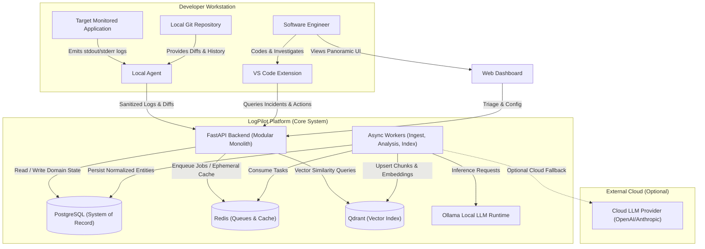
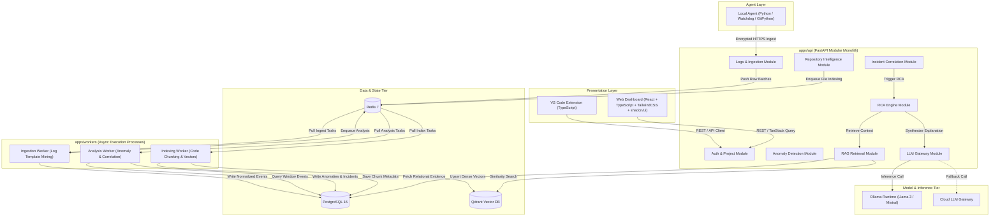
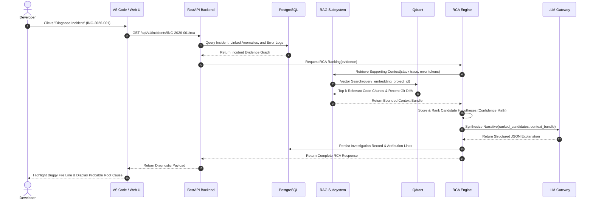
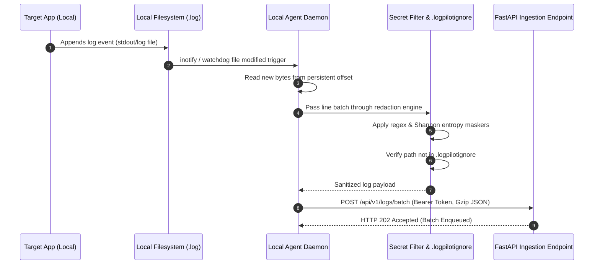
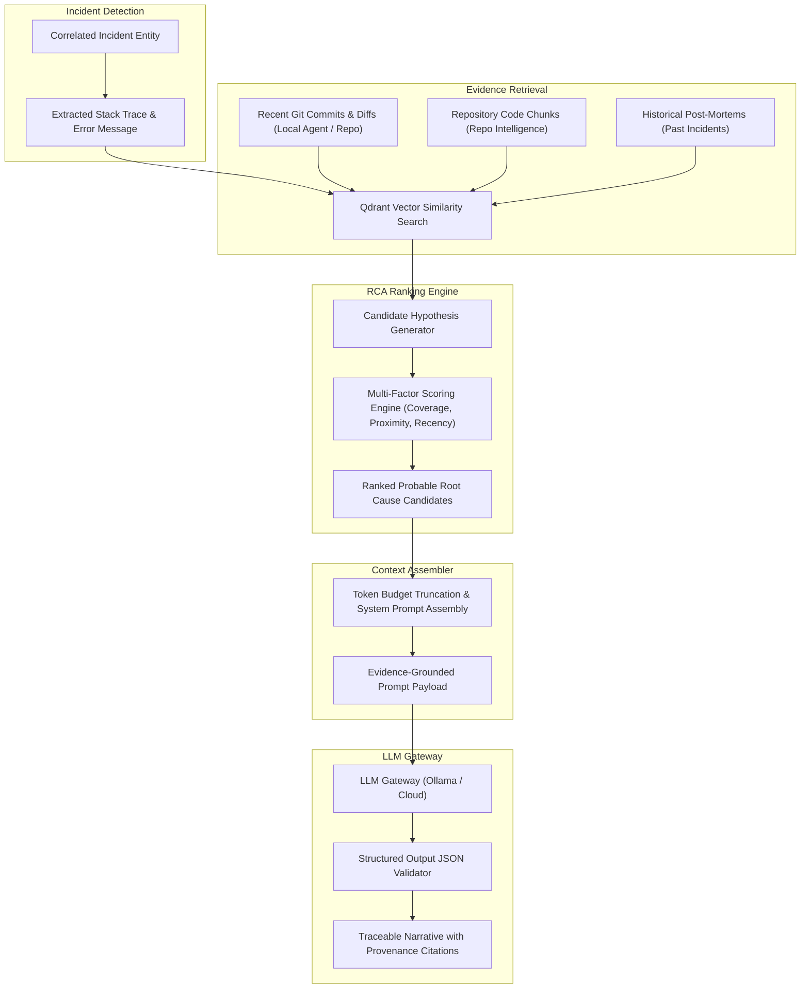

# LogPilot — System Architecture Document

**Document ID:** D03  
**Status:** Draft for Architecture Review  
**Parent Documents:** [D01 — Product Requirements Document](file:///docs/requirements/PRD.md), [D02 — V1 Scope & Acceptance Criteria](file:///docs/requirements/V1_SCOPE.md)  
**Project:** LogPilot: An Intelligent Observability and Root Cause Analysis Platform  

---

## 1. Architecture Goal & Scope

The primary architectural goal of LogPilot is to establish a concrete, robust, and extensible V1 architecture supporting the end-to-end incident investigation lifecycle:

$$\text{Application} \longrightarrow \text{Log Collection} \longrightarrow \text{Parsing / Normalization} \longrightarrow \text{Feature Extraction} \longrightarrow \text{Anomaly Detection} \longrightarrow \text{Incident Correlation} \longrightarrow \text{Repo + Git Evidence} \longrightarrow \text{Retrieval} \longrightarrow \text{RCA} \longrightarrow \text{Evidence-Grounded LLM Explanation} \longrightarrow \text{VS Code + Web Dashboard}$$

This architecture is deliberately engineered to satisfy four simultaneous needs:
1. **Academic Rigor:** Serves as a credible, publication-grade final-year computer science research project in AI-assisted systems observability.
2. **Engineering Craft:** Demonstrates senior-level software engineering discipline, production readiness, and portfolio excellence.
3. **Reproducible Experimentation:** Facilitates controlled, deterministic baseline benchmarks (Experiments A–F) for anomaly detection, RAG retrieval accuracy, and RCA precision.
4. **Future Evolutionary Runway:** Clean domain boundaries that allow seamless migration to distributed microservices, cloud telemetry pipelines, and enterprise multi-tenancy without architectural rewrites.

**V1 Constraint:** Avoid premature over-engineering. V1 does not employ distributed microservice topologies, Kafka/Flink streaming clusters, Kubernetes orchestration, or multi-region data replication.

---

## 2. Architectural Principles

Every technical choice in LogPilot conforms to twelve binding architectural principles:

1. **PostgreSQL is the Sole System of Record:** All authoritative domain entities, configurations, incidents, evidence associations, and audit records reside in relational PostgreSQL.
2. **Qdrant is a Transient Retrieval Index:** Vector embeddings and chunk indices are read-accelerated projection structures. If Qdrant is wiped, the vector index can be reconstructed entirely from PostgreSQL and repository source files.
3. **Redis is Infrastructure, Not Domain State:** Redis hosts asynchronous task queues, ephemeral cache keys, and pub/sub notifications. No permanent domain object relies on Redis persistence.
4. **The Incident is the Primary Investigation Object:** Individual log lines are raw telemetry inputs; anomalies are mathematical signals; incidents are correlated operational realities that developers triage and resolve.
5. **Strict Functional Separation:**
   - **ML Subsystem:** Detects statistical and template deviations; produces numeric anomaly scores.
   - **Incident Correlation Engine:** Evaluates deterministic rules and temporal clustering; decides incident lifecycle state.
   - **RCA Engine:** Evaluates candidate failure paths; ranks causal hypotheses using multi-source evidence weights.
   - **RAG Subsystem:** Retrieves pertinent repository chunks, diffs, and historical incident records.
   - **LLM Gateway:** Synthesizes and articulates evidence into human-readable narratives.
6. **Immutable Evidence Traceability:** Every hypothesis, explanation, or file pointer presented to the user must link directly to an immutable evidence hash, log event ID, source file range, or commit SHA.
7. **Modular Monolith over Distributed Microservices:** Core business logic lives inside a unified, strongly typed codebase (`apps/api/`) with explicit module boundaries, preventing distributed transaction overhead and network partition complexity in V1.
8. **Correctness over Premature Optimization:** Deterministic parsing, strict secret redaction, and bounded context assembly take precedence over aggressive asynchronous concurrency or premature latency tuning.
9. **Security and Privacy are First-Class:** Telemetry and source code never leave trust boundaries uninspected. Secret redaction occurs at the source before network transmission.
10. **Reproducible Experimentation:** ML pipelines, retrieval strategies, and evaluation harnesses must be deterministic, seed-controlled, and decoupled from interactive user sessions.
11. **No Autonomous Production Modification:** LogPilot is an observational, diagnostic copilot. It advises, explains, and pinpoints; it never executes unsanctioned code mutations or deployment rollbacks in V1.
12. **Pragmatic Technology Selection:** Technologies are adopted only when solving a concrete, non-negotiable V1 functional requirement.

---

## 3. High-Level Architecture Overview

LogPilot adopts a **Modular Monolith** backend architecture with decoupled asynchronous worker execution processes sharing a common domain layer:

```
┌─────────────────────────────────────────────────────────────────────────────┐
│                            Developer Workstations                           │
│                                                                             │
│   ┌───────────────────────────┐             ┌───────────────────────────┐   │
│   │     VS Code Extension     │             │       Web Dashboard       │   │
│   │    (TypeScript/Extension) │             │(React/TS/Tailwind/shadcn) │   │
│   └─────────────┬─────────────┘             └─────────────┬─────────────┘   │
│                 │                                         │                 │
│                 ▼                                         │                 │
│   ┌───────────────────────────┐                           │                 │
│   │     Local Agent (CLI)     │                           │                 │
│   │  (Python/Watchdog/Git)    │                           │                 │
│   └─────────────┬─────────────┘                           │                 │
└─────────────────┼─────────────────────────────────────────┼─────────────────┘
                  │ HTTPS / JSON API                        │ HTTPS / REST
                  ▼                                         ▼
┌─────────────────────────────────────────────────────────────────────────────┐
│                             FastAPI Backend                                 │
│                           (Modular Monolith)                                │
│                                                                             │
│   ┌───────────────┐ ┌───────────────┐ ┌───────────────┐ ┌───────────────┐   │
│   │ Logs Module   │ │Anomaly Module │ │Incident Module│ │ Repo Module   │   │
│   └───────────────┘ └───────────────┘ └───────────────┘ └───────────────┘   │
│   ┌───────────────┐ ┌───────────────┐ ┌───────────────┐ ┌───────────────┐   │
│   │ RCA Module    │ │ RAG Module    │ │ LLM Gateway   │ │ Auth/Project  │   │
│   └───────────────┘ └───────────────┘ └───────────────┘ └───────────────┘   │
└─────────┬───────────────────┬───────────────────┬───────────────────┬───────┘
          │                   │                   │                   │
          ▼                   ▼                   ▼                   ▼
┌──────────────────┐ ┌─────────────────┐ ┌─────────────────┐ ┌─────────────────┐
│   PostgreSQL     │ │      Redis      │ │     Qdrant      │ │  Async Workers  │
│ (System of Record│ │ (Queues, Cache, │ │ (Vector Store / │ │ (Ingestion,     │
│  Relational DB)  │ │  PubSub Broker) │ │  Semantic Index)│ │  Analysis,      │
└──────────────────┘ └────────┬────────┘ └─────────────────┘ │  Indexing)      │
                              │ Enqueue / Dequeue            └────────┬────────┘
                              └───────────────────────────────────────┘
                                          │
                                          ▼
                         ┌─────────────────────────────────┐
                         │      Intelligence Pipeline      │
                         │  • Template Miner / ML Anomaly  │
                         │  • Incident Correlator          │
                         │  • Repository Evidence Scanner  │
                         │  • RCA Scorer                   │
                         │  • LLM Gateway (Ollama / Cloud) │
                         └─────────────────────────────────┘
```

---

## 4. Component Definitions & System Boundaries

### A. VS Code Extension
- **Responsibility:** In-editor diagnostic lens for active developers. Displays active incidents, highlights implicated code lines with inline gutter decorations, renders probable root cause summaries, and offers code-navigation actions.
- **Owns:** VS Code Webview panel state, editor diagnostic/gutter decoration rendering, active workspace root detection, developer command registrations (`logpilot.diagnose`, `logpilot.openIncident`).
- **Does Not Own:** Telemetry collection logic, log ingestion parsing, incident state calculation, LLM prompt generation, long-term state persistence.
- **Inputs:** Local workspace file URI, active cursor position, user commands, incident/RCA responses from FastAPI or Local Agent.
- **Outputs:** In-editor diagnostic highlights, interactive Webview diagnostic view, navigation triggers.
- **Dependencies:** VS Code Extension API (`@types/vscode`), Local Agent HTTP client, Backend API HTTP client.

### B. Web Dashboard
- **Responsibility:** Centralized operational incident command center for teams. Offers panoramic log exploration, incident timeline visualization, topological service graphs, historical investigation reviews, and benchmark evaluation panels.
- **Owns:** Browser client-side UI rendering, interactive timeline and topology state, dashboard filter configurations, session token storage.
- **Does Not Own:** Telemetry parsing, anomaly scoring algorithms, incident determination, LLM inference.
- **Inputs:** REST API responses, WebSocket push events (log tailing and incident alerts) from FastAPI Backend.
- **Outputs:** User triage decisions (acknowledge, resolve, feedback rating), search queries, manual RCA triggers.
- **Dependencies:** React + TypeScript + TailwindCSS + shadcn/ui, TanStack Query, Charting / Topology libraries.

### C. Local Agent
- **Responsibility:** Lightweight, developer-side daemon that bridges local workstations with LogPilot. Monitors designated application log files, parses local Git commit metadata/diffs, executes pre-flight secret sanitization, and streams sanitized payloads to the Backend.
- **Owns:** File watcher state (`watchdog`), local log file pointer offsets, local Git repository discovery and diff extraction (`gitpython`/subprocess), `.logpilotignore` compliance checking.
- **Does Not Own:** Persistent project records, global anomaly model training, definitive incident creation, vector index storage, LLM inference.
- **Inputs:** Local disk log files (`.log`), local `.git` repository, `.logpilotignore` file, workspace configuration.
- **Outputs:** Redacted log batch payloads, repository metadata snapshots, Git commit/diff summaries forwarded via authenticated REST/gRPC to Backend.
- **Dependencies:** Python 3.11+, `watchdog`, `GitPython`, local filesystem access.

### D. FastAPI Backend
- **Responsibility:** Unified modular monolith API handling HTTP/REST requests, OpenAPI documentation generation, request authentication/authorization, synchronous query handling, and queue task dispatching.
- **Owns:** Route handlers, API schemas (Pydantic), request-response serialization, transaction management, dependency injection wiring.
- **Does Not Own:** Long-running CPU-intensive parsing or vector embedding generation (delegated to Async Workers).
- **Inputs:** Inbound HTTP requests from VS Code Extension, Web Dashboard, and Local Agent.
- **Outputs:** Synchronous JSON responses, WebSocket event broadcasts, task dispatch payloads sent to Redis.
- **Dependencies:** FastAPI, Starlette, Pydantic v2, SQLAlchemy 2.x, Redis client (`redis-py`).

### E. Application / Domain Services
- **Responsibility:** Encapsulates pure business logic decoupled from transport layers. Implements log ingestion pipelines, anomaly rules, incident correlation algorithms, repository indexing managers, and RCA candidate scoring.
- **Owns:** In-memory business logic, domain invariants, workflow coordination.
- **Does Not Own:** HTTP status codes, low-level database socket I/O, frontend UI concerns.
- **Inputs:** Domain request models, repository entities, worker job contexts.
- **Outputs:** Domain event objects, mutated entity representations, calculated scores.
- **Dependencies:** Domain entity definitions, repository interface ports.

### F. Ingestion Workers
- **Responsibility:** Asynchronous background processes consuming raw log batches from Redis queues; parses raw lines into structured events via log template extraction / template mining and fallback parsers.
- **Owns:** Batch log parsing execution, template extraction caching, write-batching of normalized log events into PostgreSQL.
- **Does Not Own:** Anomaly model inference, incident correlation decisions.
- **Inputs:** Job payloads containing raw log chunks, log source IDs, project IDs.
- **Outputs:** Persisted `LogEvent` and `LogTemplate` rows in PostgreSQL; downstream analysis jobs enqueued to Redis.
- **Dependencies:** Redis, PostgreSQL, log template extraction engine (TBD).

### G. Analysis Workers
- **Responsibility:** Background workers executing feature extraction, anomaly detection algorithms, and deterministic incident correlation.
- **Owns:** Sliding-window feature extraction, statistical anomaly scoring, incident clustering window evaluation, evidence linking.
- **Does Not Own:** Log parsing, LLM prompt assembly.
- **Inputs:** Extracted features, template IDs, historical event frequencies, active incident windows.
- **Outputs:** Persisted `Anomaly` records, updated `Incident` state machines, evidence candidate linkings.
- **Dependencies:** Redis, PostgreSQL, ML model inference artifacts (`scikit-learn` / lightweight PyTorch).

### H. Indexing Workers
- **Responsibility:** Background workers executing repository file parsing, source-code chunking, semantic vector embedding generation, and Qdrant upserts.
- **Owns:** File-to-chunk tokenization, batch embedding generation calls, vector payload assembly, Qdrant collection upserts.
- **Does Not Own:** Raw log parsing, RCA ranking logic.
- **Inputs:** Sanitized repository file trees, Git commit diffs, historical resolved incident summaries.
- **Outputs:** Dense vector embeddings, indexed payloads in Qdrant collections (`repo_code_chunks`, `historical_incidents`).
- **Dependencies:** Redis, PostgreSQL, Qdrant Client, Embedding Model / Inference Provider.

### I. PostgreSQL
- **Responsibility:** Authoritative relational database and single source of truth for all permanent state.
- **Owns:** System tables, ACID transaction durability, referential integrity constraints, relational queries.
- **Does Not Own:** Vector similarity search indices, high-throughput ephemeral queue state.
- **Inputs:** SQL statements via SQLAlchemy 2.x connection pools.
- **Outputs:** Authoritative entity records, query result sets.
- **Dependencies:** PostgreSQL 16+, storage volume mounts.

### J. Redis
- **Responsibility:** In-memory queue broker, ephemeral cache, and pub/sub event distribution channel.
- **Owns:** Queue lists / streams (`log_ingestion_queue`, `analysis_queue`, `indexing_queue`), rate-limiting counters, ephemeral user presence keys, pub/sub channels.
- **Does Not Own:** Canonical incident histories, user credentials, audit logs.
- **Inputs:** Redis protocol commands (`LPUSH`, `RPOP`, `SETEX`, `PUBLISH`).
- **Outputs:** Task queue payloads, cached values, pub/sub message streams.
- **Dependencies:** Redis 7+, in-memory allocation limits.

### K. Qdrant
- **Responsibility:** Dedicated vector search engine providing high-speed dense similarity retrieval over indexed code chunks, diffs, and historical incident records.
- **Owns:** HNSW vector indices, vector distance metrics (Cosine), payload filter indexing.
- **Does Not Own:** Authoritative incident metadata, relational joins, project permission policies.
- **Inputs:** Vector insertion and search queries containing embedding vectors and metadata filter predicates (`project_id = X`).
- **Outputs:** Top-$k$ nearest neighbor search results with distance scores and payload references.
- **Dependencies:** Qdrant v1.8+, persistent volume for vector segment storage.

### L. ML Subsystem
- **Responsibility:** Executes deterministic and unsupervised anomaly detection over structured log streams. Computes template frequency anomalies, error burst scores, and sliding-window statistical deviations.
- **Owns:** Feature extraction formulas, anomaly scoring normalization ($[0.0, 1.0]$), template frequency baselines.
- **Does Not Own:** Incident creation policies, LLM prompt formulation.
- **Inputs:** Windowed log event streams, template counters, historical baseline profiles.
- **Outputs:** Anomaly detection signals with confidence scores and contributing feature weights.
- **Dependencies:** Log template extraction engine (TBD), `numpy`, `scikit-learn`.

### M. Repository Intelligence Subsystem
- **Responsibility:** Extracts structural, semantic, and temporal insights from the target application codebase. Discovers source files, analyzes repository structures, parses dependencies, and inspects recent Git commits.
- **Owns:** Repository file parsing, source-code chunking boundaries, Git commit diff parsing, `.logpilotignore` rule evaluation.
- **Does Not Own:** Runtime log collection, LLM synthesis.
- **Inputs:** Local or cloned repository file paths, Git log outputs, secret-redaction filters.
- **Outputs:** Repository code chunks with metadata (file path, symbol/scope information where available, line ranges), parsed Git commit entities.
- **Dependencies:** Source-code parsers, `GitPython`, PostgreSQL.

### N. RAG / Retrieval Subsystem
- **Responsibility:** Gathers relevant contextual evidence for an active incident by querying Qdrant and PostgreSQL across three distinct context axes: source code, recent Git diffs, and historical incidents.
- **Owns:** Query vector formulation, project-scoped vector filtering, multi-source context fusion, context window token budgeting.
- **Does Not Own:** Prompt generation, LLM generation, vector index persistence.
- **Inputs:** Incident error signatures, stack trace frames, implicated file paths, query embeddings.
- **Outputs:** Deduplicated, ranked, and bounded context bundles enriched with source file and commit provenance.
- **Dependencies:** Qdrant, Embedding Provider, PostgreSQL.

### O. RCA Subsystem
- **Responsibility:** Heuristic and algorithmic root cause analysis engine. Identifies candidate failure paths by correlating stack traces with recent code changes, service dependencies, and anomaly sequences.
- **Owns:** Candidate hypothesis generation, deterministic evidence scoring algorithms, hypothesis ranking.
- **Does Not Own:** Free-form natural language generation, vector similarity searches.
- **Inputs:** Correlated incident events, stack trace frames, retrieved code chunks, recent Git diffs.
- **Outputs:** Ranked `RCACandidate` list, evidence attribution graphs, confidence score breakdowns.
- **Dependencies:** ML Subsystem outputs, Repository Intelligence, PostgreSQL.

### P. LLM Gateway
- **Responsibility:** Clean, decoupled provider abstraction for Large Language Models. Handles prompt templating, token truncation, retry logic, timeout enforcement, structured JSON schema decoding, and provider failover.
- **Owns:** Unified inference interface, provider configuration, prompt safety guards, token usage telemetry.
- **Does Not Own:** Incident correlation logic, candidate ranking formulas, vector storage.
- **Inputs:** Structured prompt payloads with strict system instructions and evidence context bundles.
- **Outputs:** Validated, schema-conforming structured JSON explanation objects containing summary, probable root cause narrative, evidence citations, and recommended investigation steps.
- **Dependencies:** Ollama HTTP client, Cloud LLM HTTP client (OpenAI-compatible protocol), Pydantic validation schemas.

### Q. Ollama Subsystem
- **Responsibility:** Default local/on-premise LLM execution runtime. Executes quantized open-source models (e.g., Llama 3 / Mistral / DeepSeek) within the developer's private compute boundary.
- **Owns:** Local model weights, GPU/CPU tensor execution, local inference socket.
- **Does Not Own:** Prompt logic, evidence ranking, database state.
- **Inputs:** Standardized completion/chat requests from LLM Gateway.
- **Outputs:** Raw token generation streams.
- **Dependencies:** Ollama runtime binary, host GPU/RAM resources.

### R. External / Cloud LLM Provider Abstraction
- **Responsibility:** Pluggable adapter allowing LogPilot to target managed cloud LLMs (OpenAI, Anthropic, Google Gemini) via a uniform interface for high-capability research evaluations.
- **Owns:** Provider-specific HTTP headers, rate-limit backoff, API token injection.
- **Does Not Own:** Local state, incident correlation.
- **Inputs:** Standardized LLM Gateway requests.
- **Outputs:** Standardized LLM Gateway response objects.
- **Dependencies:** Outbound internet HTTPS access, valid provider API credentials.

### S. Evaluation / Research Subsystem
- **Responsibility:** Standalone harness supporting reproducible academic experiments (Experiments A–F). Evaluates anomaly detection ROC-AUC, retrieval Hit@k / MRR, and RCA diagnostic accuracy against synthetic and benchmark incident suites.
- **Owns:** Test harness runners, ground-truth dataset loaders, metric calculation algorithms, experiment artifact exports (`CSV`/`JSON`).
- **Does Not Own:** Live production log ingestion, interactive UI updates.
- **Inputs:** Ground truth incident datasets, benchmark log corpora (e.g., LogHub), configurable pipeline flags.
- **Outputs:** Statistical evaluation metrics, confusion matrices, ablation study reports.
- **Dependencies:** Python scientific stack (`numpy`, `pandas`, `scipy`), PostgreSQL test fixtures.

---

## 5. Data Ownership & Storage Architecture

LogPilot enforces an unambiguous, non-negotiable data ownership boundary across its three storage engines:

```
┌─────────────────────────────────────────────────────────────────────────────┐
│                             DATA OWNERSHIP MATRIX                           │
├──────────────────────┬──────────────────────┬───────────────────────────────┤
│ PostgreSQL           │ Qdrant               │ Redis                         │
│ (System of Record)   │ (Transient Vector)   │ (Infrastructure / Ephemeral)  │
├──────────────────────┼──────────────────────┼───────────────────────────────┤
│ • Projects & Orgs    │ • Code Embeddings    │ • Celery/Queue Task Lists     │
│ • User Accounts      │ • Diff Embeddings    │ • Dead-Letter Queues (DLQ)    │
│ • Log Sources        │ • Incident Embeddings│ • Sliding Window Counters     │
│ • Normalized Events  │ • Chunk Payloads     │ • Anomaly Baselines Cache     │
│ • Log Templates      │ • Similarity Metrics │ • Ephemeral Session Keys      │
│ • Anomaly Records    │ • Project Scoped IDs │ • Pub/Sub Event Broadcasts    │
│ • Incidents & State  │                      │ • Distributed Locks           │
│ • Evidence Records   │                      │                               │
│ • RCA Candidates     │                      │                               │
│ • Audit Log Trail    │                      │                               │
│ • System Settings    │                      │                               │
└──────────────────────┴──────────────────────┴───────────────────────────────┘
```

### Storage Governance Invariants:
1. **PostgreSQL Authoritative Rule:** Any piece of business state that cannot be deterministically regenerated must reside in PostgreSQL. If Qdrant and Redis are deleted simultaneously, LogPilot loses zero historical incidents, zero audit records, and zero configuration.
2. **Qdrant Projection Rule:** Qdrant is an index, not a database. Every vector stored in Qdrant corresponds to an authoritative entity in PostgreSQL or a commit in the Git repository via a foreign metadata pointer (`project_id`, `file_path`, `chunk_id`). Qdrant **MUST NOT** store primary business state.
3. **Redis Volatility Rule:** Redis is configured with LRU memory eviction policies for cache namespaces and persistence (`AOF`/`RDB`) for queues. However, application services must treat Redis data as strictly ephemeral. Redis **MUST NOT** store primary business state.

---

## 6. Processing Model: Synchronous vs. Asynchronous

LogPilot divides computational operations into synchronous and asynchronous execution paths based on latency tolerance, user-blocking nature, and failure recovery dynamics.

```
                           Incoming Workload
                                   │
               ┌───────────────────┴───────────────────┐
               ▼                                       ▼
     Synchronous Processing                  Asynchronous Processing
     (FastAPI Main Thread Pool)              (Background Worker Pool)
               │                                       │
     • Authentication & RBAC                 • Raw Log Ingestion & Template Extraction
     • Project & Source Configuration        • Template Frequency Anomaly Detection
     • Incident Query & Detail Retrieval     • Incident Correlation Clustering
     • Active Investigation State Updates    • Repository Code Chunking & Embedding
     • Lightweight Schema Validation         • Qdrant Vector Upserts
     • Manual RCA Trigger Dispatch           • Full RAG Context Assembly
     • Health & Liveness Probes              • LLM Generation & Explanation
                                             • Benchmark Evaluation Suites
```

### Rationale:
- **Synchronous Operations:** All user interactions requiring immediate deterministic confirmation ($\le 100\text{ ms}$) run synchronously in FastAPI. Blocking these on background queues would cause UI sluggishness and fragile state synchronization.
- **Asynchronous Operations:** Telemetry parsing, sliding-window statistical calculation, neural embeddings, vector retrieval, and LLM completions exhibit variable latencies ranging from $200\text{ ms}$ to $> 10\text{ seconds}$. Running these on asynchronous worker processes prevents thread starvation in the API tier, isolates memory-intensive workloads, and enables resilient retry mechanisms.

---

## 7. Core Log Processing & Intelligence Pipeline

The end-to-end telemetry lifecycle progresses through a 12-stage sequential pipeline with explicit data models, persistence boundaries, and failure mitigations:

```
[Raw Log Batch]
      │
      ▼ (Stage 1: Collector - Local Agent / Webhook)
[Pre-filtered Log Batch]
      │
      ▼ (Stage 2: Parser - Regex / Structure Unpacker)
[Parsed Token Stream]
      │
      ▼ (Stage 3: Normalizer - Timestamp, Level, Source mapping)
[NormalizedLogEvent] (PostgreSQL Batch Write)
      │
      ▼ (Stage 4: Template Extraction - Log Template Mining)
[LogTemplate + TemplateID] (PostgreSQL Reference)
      │
      ▼ (Stage 5: Feature Extraction - Sliding Window Metrics)
[FeatureVector] (Redis Cache)
      │
      ▼ (Stage 6: Anomaly Detection - Statistical / Frequency Scoring)
[AnomalySignal] (PostgreSQL Write if Score >= Threshold)
      │
      ▼ (Stage 7: Incident Correlation - Temporal & Service Clustering)
[Incident] (PostgreSQL State Machine)
      │
      ▼ (Stage 8: Evidence Collection - Log, Stack Trace, Git Diff, Code Chunks)
[EvidenceBundle] (PostgreSQL Association)
      │
      ▼ (Stage 9: RCA Candidate Ranking - Multi-Factor Heuristic Engine)
[RankedRCACandidates] (PostgreSQL Records)
      │
      ▼ (Stage 10: Retrieval - Dense Search in Qdrant)
[ContextChunks] (In-Memory Bounded Context)
      │
      ▼ (Stage 11: LLM Explanation - Gateway to Ollama/Cloud)
[StructuredIncidentExplanation] (PostgreSQL Record)
      │
      ▼ (Stage 12: Incident Presentation - VS Code / Web UI)
[Rendered UI Incident & Diagnostics]
```

### Stage-by-Stage Specification:

| Stage | Input Data | Output Data | Persistence Boundary | Failure & Idempotency Strategy |
|---|---|---|---|---|
| **1. Collector** | Raw log stream / files | Sanitized log batch | Memory / Local Agent buffer | Buffer locally on agent; retry transmission on network drops. |
| **2. Parser** | Raw string line | Tokenized key-value pairs | In-memory worker | Unparseable logs routed to raw fallback schema; error counter incremented. |
| **3. Normalizer** | Tokenized tokens | `NormalizedLogEvent` | Batch inserted into PostgreSQL | Idempotent via `(project_id, source_id, log_hash, timestamp)` unique constraint. |
| **4. Template Miner** | Normalized message body | `TemplateID` + variable tokens | `LogTemplate` cached in Redis; saved in PostgreSQL | Template state cached in Redis. Graceful fallback to regex wildcarding on template error. |
| **5. Feature Extraction**| Stream of template occurrences | Time-window feature vector | Redis sliding window state | Missing windows imputed with baseline zero; non-blocking. |
| **6. Anomaly Detection**| Time-window feature vector | `Anomaly` record + score | PostgreSQL (`anomalies` table) | Deterministic fallback rule (e.g., error burst count) if ML scoring fails. |
| **7. Incident Correlation**| Anomalies within time window $\Delta t$ | `Incident` entity | PostgreSQL (`incidents` table) | Idempotent cluster matching based on active incident window and service key. |
| **8. Evidence Collection**| Incident ID + stack trace + source | `Evidence` records | PostgreSQL (`evidence` table) | Hash-based deduplication of evidence links. |
| **9. RCA Candidate Ranking**| Evidence graph + Git history | Ranked list of probable causes | PostgreSQL (`rca_candidates` table) | Heuristic score normalization. Deterministic rank ordering. |
| **10. Retrieval** | Incident context + query vectors | Top-$k$ code chunks & diffs | In-memory worker context | Fallback to PostgreSQL lexical lookup if Qdrant search times out. |
| **11. LLM Explanation** | Bounded context prompt | Structured JSON explanation | PostgreSQL (`investigations` table) | Circuit breaker on timeout. Incident remains valid even if LLM fails. |
| **12. Presentation** | Persisted incident & RCA entities | VS Code / Web UI state | Client-side memory | Cached in TanStack Query / VS Code state; poll or WebSocket push. |

---

## 8. Incident-Centric Design & Evidence Traceability

In LogPilot, **the Incident is the primary investigation object**. Logs are raw observational telemetry; anomalies are mathematical detections. An incident represents a correlated operational disruption requiring human awareness and resolution.

```
┌─────────────────────────────────────────────────────────────────────────────┐
│                       INCIDENT RELATIONSHIP HIERARCHY                       │
│                                                                             │
│                                Project                                      │
│                                   │                                         │
│                            Log Source(s)                                    │
│                                   │                                         │
│                           Normalized Events                                 │
│                                   │                                         │
│                           Detected Anomalies                                │
│                                   │                                         │
│                                Incident                                     │
│                     (Correlated Event Cluster)                              │
│                                   │                                         │
│                    ┌──────────────┴──────────────┐                          │
│                    ▼                             ▼                          │
│             Direct Evidence               Retrieved Evidence                │
│       (Stack Traces, Error Logs)     (Git Commits, Code Chunks)             │
│                    │                             │                          │
│                    └──────────────┬──────────────┘                          │
│                                   │                                         │
│                          RCA Candidate Ranking                              │
│                     ("Probable Root Causes" Ranked)                         │
│                                   │                                         │
│                                   ▼                                         │
│                       Evidence-Grounded Summary                             │
│                  (Synthesized via LLM, Traceable)                           │
└─────────────────────────────────────────────────────────────────────────────┘
```

### Grounding and Causality Rules:
- **Terminology Standard:** All user-facing and internal documentation strictly utilizes the term **"Probable Root Cause"**. LogPilot explicitly rejects claims of guaranteed causal discovery.
- **Traceability Chain:** Every RCA conclusion displayed in the UI must provide a clickable, direct link back to its underlying evidence:
  $$\text{RCA Candidate} \longrightarrow \text{Evidence Link} \longrightarrow \text{Source File / Line Range / Git SHA / Log Event ID}$$
- **Zero Hallucination Tolerance:** The synthesis engine will reject any LLM response that introduces file paths, variable names, or root cause rationales not present in the supplied evidence context.

---

## 9. Functional Boundaries: ML, Incident Engine, RCA, RAG, and LLM

To guarantee high reliability, strict boundaries are enforced across all intelligence subsystems:

```
┌─────────────────────────────────────────────────────────────────────────────┐
│                     INTELLIGENCE SUBSYSTEM BOUNDARIES                       │
├─────────────────────┬───────────────────────────────────────────────────────┤
│ Subsystem           │ Explicit Boundaries & Responsibilities               │
├─────────────────────┼───────────────────────────────────────────────────────┤
│ **ML Subsystem**    │ • Computes statistical anomaly scores from log streams│
│                     │ • Operates on numerical features & template counts    │
│                     │ • DOES NOT declare incidents or assign blame          │
├─────────────────────┼───────────────────────────────────────────────────────┤
│ **Incident Engine** │ • Correlates anomalies across time and service bounds │
│                     │ • Applies deterministic thresholds & debounce windows │
│                     │ • Declares, merges, and transitions incident states   │
│                     │ • DOES NOT generate code explanations                 │
├─────────────────────┼───────────────────────────────────────────────────────┤
│ **RCA Engine**      │ • Identifies and scores candidate failure hypotheses  │
│                     │ • Matches stack traces to Git diffs and code symbols  │
│                     │ • Calculates objective multi-factor confidence scores │
│                     │ • DOES NOT perform open-ended text generation         │
├─────────────────────┼───────────────────────────────────────────────────────┤
│ **RAG Subsystem**   │ • Retrieves relevant code chunks, diffs, past post-   │
│                     │   mortems via vector similarity & metadata filters    │
│                     │ • Assembles bounded, token-budgeted context bundles   │
│                     │ • DOES NOT synthesize text or judge truth             │
├─────────────────────┼───────────────────────────────────────────────────────┤
│ **LLM Gateway**     │ • Synthesizes provided evidence into clear narratives │
│                     │ • Structures hypotheses into actionable summaries     │
│                     │ • STRICTLY FORBIDDEN from creating incidents,         │
│                     │   hallucinating unsupplied files, or altering code    │
└─────────────────────┴───────────────────────────────────────────────────────┘
```

---

## 10. Repository Intelligence & Git Evidence Subsystem

Repository Intelligence provides the contextual semantic bridge connecting runtime error telemetry to static codebases and dynamic code changes:

```
Repository Source / Local Workspace
       │
       ▼ (Pre-scan Filtering: .logpilotignore + Default Blacklist)
Sanitized Repository Tree
       │
       ├─────────────────────────────────┬─────────────────────────────────┐
       ▼                                 ▼                                 ▼
Structural Analysis                Git Intelligence                 Configuration Parsing
• Source Structure Analysis       • Commit SHA History             • Dockerfile inspection
• Source-Code Chunking            • Author & Timestamp Metadata    • Dependency files
• File Hierarchy Topology         • Changed File Diffs (Unified)   • Env structures (no secrets)
       │                                 │                                 │
       └─────────────────────────────────┼─────────────────────────────────┘
                                         │
                                         ▼
                            Embedding & Indexing Pipeline
                            • Token budget chunking
                            • Embedding generation
                            • Qdrant Vector Collections
                            • PostgreSQL File Metadata
```

### Discovery, Filtering & Chunking:
1. **Discovery:** Discovers source code files, build configurations, and container configurations.
2. **Filtering:** Enforces strict exclusions via `.logpilotignore` and hardcoded security rules before files are accessed.
3. **Source-Code Chunking:** Rather than arbitrary line splitting, repository files are partitioned into bounded source-code chunks preserving semantic coherence and syntactic context.
4. **Git Delta Extraction:** Inspects recent commit history ($N$ most recent commits or active branch diffs) to associate modified files, function changes, and commit authors with failure windows.

---

## 11. Security Architecture & Trust Boundaries

Security and developer privacy are fundamental, non-negotiable architectural constraints.

```
┌─────────────────────────────────────────────────────────────────────────────┐
│                          TRUST BOUNDARY ARCHITECTURE                        │
│                                                                             │
│  [ UNTRUSTED / EXTERNAL ENVIRONMENT ]                                       │
│  • Raw logs from application stdout/stderr                                  │
│  • Unchecked repository files                                               │
│                                                                             │
│  ═════════════════════════════════════════════════════════════════════════  │
│  ▼ Trust Boundary 1: Local Agent Pre-Ingestion Filter                       │
│    • Secret Redaction Engine (Regex + Shannon Entropy Scanners)             │
│    • Path Filter (.logpilotignore, .env*, *.pem, *.key, credentials)        │
│                                                                             │
│  [ DEVELOPER WORKSTATION BOUNDARY ]                                         │
│  • VS Code Extension & Local Agent                                          │
│                                                                             │
│  ═════════════════════════════════════════════════════════════════════════  │
│  ▼ Trust Boundary 2: Authenticated Network Transport (HTTPS / Bearer Auth)  │
│    • TLS 1.3 Encryption                                                     │
│    • Project API Key / User JWT Authentication                              │
│                                                                             │
│  [ LOGPILOT BACKEND SECURE ENCLAVE ]                                        │
│    • FastAPI Application (Role-Based Access Control, Project Isolation)     │
│    • PostgreSQL / Redis / Qdrant (Internal Docker Network)                  │
│                                                                             │
│  ═════════════════════════════════════════════════════════════════════════  │
│  ▼ Trust Boundary 3: Context Minimization Filter for LLM                    │
│    • Bounded Evidence Truncation                                            │
│    • PII / Masking Check                                                    │
│    • Zero Secret Leakage Verification                                       │
│                                                                             │
│  [ MODEL EXECUTION ENCLAVE ]                                                │
│    • Ollama Runtime (Local / On-Premise - Private Boundary)                 │
│    • Optional: Cloud LLM Provider (Strict HTTPS, No-Training Opt-Out)      │
└─────────────────────────────────────────────────────────────────────────────┘
```

### Mandatory Exclusion Rules (Hardcoded Default Blacklist):
LogPilot agents and backend scanners immediately drop and ignore any path matching:
```
.env*
*.pem
*.key
*id_rsa*
*credentials*
*secrets*
node_modules/
.git/
dist/
build/
__pycache__/
*.pyc
```

### Ollama Privacy Disclaimer:
*Deploying Ollama locally provides network-level data residency and prevents telemetry from leaving host infrastructure. However, local deployment is **NOT** automatically equivalent to absolute security. Applications must still enforce strict secret redaction, context minimization, process isolation, and host OS access controls.*

---

## 12. Local Agent Architecture

The Local Agent acts as a high-performance, resource-conscious developer daemon:

```
┌─────────────────────────────────────────────────────────────────────────────┐
│                         LOCAL AGENT INTERNAL DESIGN                         │
│                                                                             │
│   ┌────────────────────┐  ┌────────────────────┐  ┌─────────────────────┐   │
│   │ File Watcher Engine│  │   Git Discovery    │  │  Workspace Scanner  │   │
│   │ (watchdog / inotify│  │ (git log/diff repo)│  │  (File Enumerator)  │   │
│   └─────────┬──────────┘  └─────────┬──────────┘  └──────────┬──────────┘   │
│             │                       │                        │              │
│             ▼                       ▼                        ▼              │
│   ┌─────────────────────────────────────────────────────────────────────┐   │
│   │                       Local Secret Redaction                        │   │
│   │     • Regex Masking (API Keys, Tokens, Connection Strings)          │   │
│   │     • Shannon Entropy Scanner (High-Entropy Secret Detection)       │   │
│   │     • .logpilotignore Filtering                                     │   │
│   └──────────────────────────────────┬──────────────────────────────────┘   │
│                                      │                                      │
│                                      ▼                                      │
│   ┌─────────────────────────────────────────────────────────────────────┐   │
│   │                      Batching & Dispatch Client                     │   │
│   │     • In-memory ring buffer (handles temporary disconnects)         │   │
│   │     • Gzip compressed HTTP/REST batch transmission                  │   │
│   │     • Authentication header management                              │   │
│   └──────────────────────────────────┬──────────────────────────────────┘   │
└──────────────────────────────────────┼──────────────────────────────────────┘
                                       │ HTTPS / Bearer Token
                                       ▼
                             FastAPI Ingestion Endpoint
```

### Authority Invariant:
The Local Agent is strictly an **ingestion collector and local context reader**. It **DOES NOT** hold authoritative domain state, make incident decisions, or perform RCA calculations.

---

## 13. API Architecture & Canonical Schemas

LogPilot standardizes on **FastAPI** as its primary API engine.

```
┌─────────────────────────────────────────────────────────────────────────────┐
│                        CANONICAL SCHEMA FLOW PIPELINE                       │
│                                                                             │
│                        Pydantic Models (Python)                             │
│                      (Canonical Backend Source)                             │
│                                   │                                         │
│                                   ▼                                         │
│                         FastAPI Route Models                                │
│                                   │                                         │
│                                   ▼                                         │
│                      OpenAPI Specification (JSON)                           │
│                      (Generated Automated Schema)                           │
│                                   │                                         │
│                                   ▼                                         │
│                     OpenAPI TypeScript Generator                            │
│                                   │                                         │
│                  ┌────────────────┴────────────────┐                        │
│                  ▼                                 ▼                        │
│       TypeScript API Client              TypeScript Domain Types            │
│       (`packages/client/`)               (`packages/client/types.ts`)       │
│                  │                                 │                        │
│         ┌────────┴────────┐               ┌────────┴────────┐               │
│         ▼                 ▼               ▼                 ▼               │
│   Web Dashboard   VS Code Extension Web Dashboard   VS Code Extension       │
└─────────────────────────────────────────────────────────────────────────────┘
```

### Schema Rules:
1. **Canonical Authority:** Backend Pydantic models define all system contracts.
2. **No Manual Duplication:** TypeScript interfaces for API schemas must **never** be manually written or maintained. They are strictly generated from the OpenAPI specification into `packages/client/`.
3. **Database Decoupling:** API request/response Pydantic models are decoupled from internal SQLAlchemy ORM entities to prevent internal schema leaks.

---

## 14. Database Architecture Domains (PostgreSQL)

PostgreSQL organizes the system of record across twelve functional domain areas. *(Detailed relational schemas and DDL are formally deferred to document D05)*:

1. **Identity & Access Management:** Users, hashed credentials, API tokens, roles (`admin`, `engineer`, `viewer`).
2. **Projects & Tenancy:** Project records, organization bindings, settings, retention policies.
3. **Repositories:** Registered code repositories, branches, remote URLs, clone paths, indexing statuses.
4. **Log Sources:** Registered telemetry emitters (files, containers, services, collector agents).
5. **Normalized Events:** Structured log events with standardized timestamps, levels, hashes, and source IDs.
6. **Log Templates:** Extracted log templates, wildcard signatures, and occurrence counts.
7. **Anomalies:** Detected anomaly instances, anomaly types, confidence scores, window metadata.
8. **Incidents:** Primary incident entities, severity levels, lifecycle states (`OPEN`, `INVESTIGATING`, `RESOLVED`, `IGNORED`), window bounds.
9. **Evidence Associations:** Join entities linking specific log events, code chunks, git commits, and anomalies to an incident.
10. **RCA Candidates:** Ranked candidate hypotheses, calculated confidence metrics, ranking rationale.
11. **Investigations:** Historical investigation sessions, user annotations, generated LLM explanations, feedback scores.
12. **Audit Logging:** Tamper-evident operational audit logs recording all user and administrative actions.

---

## 15. Retrieval Architecture (RAG)

Retrieval operates across three contextual planes (Code, Changes, History) using a staged evolution strategy:

```
Incident Context: Error Signature, Stack Trace Frames, Implicated Files
                                │
                                ▼
                 Embedding Model (Dense Vectorization)
                                │
                                ▼
┌─────────────────────────────────────────────────────────────────────────────┐
│                       MULTI-AXIS RETRIEVAL IN QDRANT                        │
│                                                                             │
│   Collection 1:                   Collection 2:              Collection 3:  │
│   `repo_code_chunks`              `git_commit_diffs`         `incidents`    │
│   Dense vector search             Dense vector search        Dense search   │
│   Filter: project_id              Filter: project_id         Filter: status │
│   & file_path in stack            & commit_date in window    = RESOLVED     │
└──────────────┬────────────────────────────┬─────────────────────────┬───────┘
               │                            │                         │
               └────────────────────┬───────┴─────────────────────────┘
                                    │
                                    ▼
                      Metadata Filtering & Deduplication
                                    │
                                    ▼
                      Context Budgeting & Assembly
                                    │
                                    ▼
                      Bounded Context Prompt to LLM
```

### Staged Evolution Strategy:
- **V1 Baseline:** Dense vector similarity search (Cosine distance via Qdrant) combined with strict project-level metadata pre-filtering and deterministic context window budgeting.
- **V2 / Research Phase:** Introduction of hybrid sparse-dense retrieval (BM25 + Dense) and Cross-Encoder neural reranking (Experiment B in research framework).

---

## 16. LLM Gateway & Provider Abstraction

LogPilot enforces strict isolation between analytical code and LLM inference engines through a unified Gateway pattern:

```
┌─────────────────────────────────────────────────────────────────────────────┐
│                          LLM GATEWAY ARCHITECTURE                           │
│                                                                             │
│                         RCA / Explanation Service                           │
│                                     │                                       │
│                                     ▼                                       │
│                         Structured Request Object                           │
│                   (System Prompt, Evidence Context, Schema)                 │
│                                     │                                       │
│                                     ▼                                       │
│                       ┌───────────────────────────┐                         │
│                       │        LLM Gateway        │                         │
│                       │  • Prompt Token Truncator │                         │
│                       │  • Timeout & Retry Policy │                         │
│                       │  • JSON Schema Validator  │                         │
│                       └─────────────┬─────────────┘                         │
│                                     │                                       │
│                        BaseLLMProvider Interface                            │
│                                     │                                       │
│                   ┌─────────────────┴─────────────────┐                     │
│                   ▼                                   ▼                     │
│        OllamaProvider Adapter              CloudLLMProvider Adapter         │
│        (Default Local Execution)           (OpenAI/Anthropic Protocol)      │
│                   │                                   │                     │
│                   ▼                                   ▼                     │
│             Local Ollama Server                 Managed Cloud API           │
│        (e.g., Llama 3 / Mistral)          (e.g., GPT-4o / Claude 3.5)       │
└─────────────────────────────────────────────────────────────────────────────┘
```

### Gateway Invariants:
1. **Model Agnosticism:** Downstream consumers (RCA engine, API handlers) depend only on `BaseLLMProvider` and structured Pydantic schemas. They have zero direct awareness of Ollama or cloud SDKs.
2. **Schema Enforcement:** The gateway enforces JSON-mode output validation. If a model generates malformed JSON, the gateway automatically executes an immediate repair retry before reporting failure.
3. **Graceful Degradation:** If an LLM provider times out or crashes, the incident remains fully accessible in the UI with its complete evidence graph and deterministic RCA rankings. An LLM failure never invalidates an incident.

---

## 17. Failure Handling, Resilience & Idempotency

LogPilot defines explicit fault domains to ensure that failure in one component does not cascade across the system:

```
┌─────────────────────────────────────────────────────────────────────────────┐
│                          FAULT ISOLATION BOUNDARIES                         │
├─────────────────────┬───────────────────────────────────────────────────────┤
│ Failure Scenario    │ Architectural Mitigation & System Behavior            │
├─────────────────────┼───────────────────────────────────────────────────────┤
│ **Malformed Logs**  │ Dropped into a raw fallback ingestion table; invalid  │
│                     │ lines never block processing of subsequent lines.     │
├─────────────────────┼───────────────────────────────────────────────────────┤
│ **Ingestion Spike** │ Redis queue buffers inbound volume; backpressure      │
│                     │ signals return HTTP 429 to collectors if queue limits.│
├─────────────────────┼───────────────────────────────────────────────────────┤
│ **Worker Failure**  │ Unacknowledged tasks re-queued via Redis; worker tasks│
│                     │ are idempotent via unique event hashes in PostgreSQL. │
├─────────────────────┼───────────────────────────────────────────────────────┤
│ **Database Outage** │ Ingestion workers buffer parsed batches in Redis until│
│ (PostgreSQL)        │ database connectivity is restored.                    │
├─────────────────────┼───────────────────────────────────────────────────────┤
│ **Redis Outage**    │ Local Agent retains buffer on local disk; API rejects │
│                     │ new ingestion with HTTP 503 while preserving reads.   │
├─────────────────────┼───────────────────────────────────────────────────────┤
│ **Qdrant Failure**  │ Retrieval falls back to PostgreSQL lexical matching;  │
│                     │ primary incident state and RCA engine remain intact.  │
├─────────────────────┼───────────────────────────────────────────────────────┤
│ **LLM Failure /     │ Circuit breaker trips after timeout ($30\text{s}$);   │
│   Ollama Offline**  │ UI displays complete evidence & deterministic ranking │
│                     │ with a "Synthesis unavailable" banner.                │
├─────────────────────┼───────────────────────────────────────────────────────┤
│ **Git Unavailable** │ RCA engine scores based solely on log stack traces    │
│                     │ and marks commit correlation evidence as skipped.     │
└─────────────────────┴───────────────────────────────────────────────────────┘
```

---

## 18. Observability of LogPilot

LogPilot implements comprehensive internal telemetry to ensure operational visibility into its own services:

- **Structured Application Logging:** Structured JSON logging across all backend and worker services with trace correlation IDs (`trace_id`, `project_id`, `incident_id`).
- **Operational Metrics:**
  - Ingestion throughput (events/sec) and parse error rates.
  - Redis queue lengths and consumer worker lag.
  - Log template creation rate and cache hit ratios.
  - Anomaly detection scoring latencies.
  - Qdrant query latencies ($p50, p95, p99$).
  - LLM inference latency, prompt token count, and completion token count.
- **Audit Logging:** Dedicated, immutable PostgreSQL audit log tracking user authentication, incident state transitions, settings changes, and export actions.
- **OpenTelemetry Standard:** Codebase instruments spans using OpenTelemetry standards, allowing pluggable export to external collectors without architectural rewires.

---

## 19. Testing Architecture

Testing is partitioned across four distinct verification tiers:

```
┌─────────────────────────────────────────────────────────────────────────────┐
│                             TESTING PYRAMID                                 │
│                                                                             │
│                       ┌─────────────────────────┐                           │
│                       │   Research Benchmark    │                           │
│                       │   (ROC-AUC, Hit@k, MRR) │                           │
│                       └────────────┬────────────┘                           │
│                                    │                                        │
│                       ┌────────────┴────────────┐                           │
│                       │   End-to-End Workflow   │                           │
│                       │ (Golden Demo Scenario)  │                           │
│                       └────────────┬────────────┘                           │
│                                    │                                        │
│                       ┌────────────┴────────────┐                           │
│                       │   Integration Tests     │                           │
│                       │ (API + DB + Worker Test)│                           │
│                       └────────────┬────────────┘                           │
│                                    │                                        │
│                       ┌────────────┴────────────┐                           │
│                       │       Unit Tests        │                           │
│                       │ (Domain, Parsers, Rules)│                           │
│                       └─────────────────────────┘                           │
└─────────────────────────────────────────────────────────────────────────────┘
```

1. **Unit Tests:** High-speed, isolated tests verifying regex parsers, log template extraction logic, anomaly feature extraction, RCA ranking math, and secret redaction filters.
2. **Integration Tests:** Verification of database repositories against a containerized PostgreSQL instance, Redis queue task dispatch/consumption, Qdrant vector operations, and mock LLM gateway responses.
3. **End-to-End Tests:** Automated execution of the 19-step Golden Demo scenario (verifying telemetry ingestion $\rightarrow$ anomaly $\rightarrow$ incident $\rightarrow$ evidence $\rightarrow$ VS Code display).
4. **Research Benchmark Harness:** Automated evaluation suites executing Experiments A–F against synthetic and public log datasets, generating reproducible validation metrics.

---

## 20. Deployment Architecture (V1 Target)

The V1 system targets a single-host, containerized **Docker Compose** deployment topology for maximum reproducibility:

```
┌─────────────────────────────────────────────────────────────────────────────┐
│                          V1 DOCKER COMPOSE TOPOLOGY                         │
│                                                                             │
│  Host Workstation / Server Environment                                      │
│                                                                             │
│   ┌─────────────────────────────────────────────────────────────────────┐   │
│   │                         Web Tier Container                          │   │
│   │              LogPilot Web Dashboard (React / Port 3000)             │   │
│   └──────────────────────────────────┬──────────────────────────────────┘   │
│                                      │                                      │
│   ┌──────────────────────────────────▼──────────────────────────────────┐   │
│   │                         API Tier Container                          │   │
│   │               LogPilot FastAPI Backend (Port 8000)                  │   │
│   └───────────────┬──────────────────┬──────────────────┬───────────────┘   │
│                   │                  │                  │                   │
│   ┌───────────────▼───────────┐ ┌────▼──────────┐ ┌─────▼───────────────┐   │
│   │   Worker Tier Container   │ │   PostgreSQL  │ │        Redis        │   │
│   │ LogPilot Async Workers    │ │   Container   │ │      Container      │   │
│   │ (Ingestion, Analysis,     │ │  (Port 5432)  │ │     (Port 6379)     │   │
│   │  Indexing processes)      │ │               │ │                     │   │
│   └───────────────┬───────────┘ └───────────────┘ └─────────────────────┘   │
│                   │                                                         │
│   ┌───────────────▼───────────┐                 ┌───────────────────────┐   │
│   │     Qdrant Container      │                 │    Ollama Container   │   │
│   │       (Port 6333)         │                 │   (Port 11434 / GPU)  │   │
│   └───────────────────────────┘                 └───────────────────────┘   │
└─────────────────────────────────────────────────────────────────────────────┘
```

*Note: Kubernetes configurations and multi-region clustering are explicitly excluded from V1.*

---

## 21. Multi-Tenancy Strategy

- **V1 Reality:** Strict **Project-Level Isolation**. Every entity stored in PostgreSQL and Qdrant requires a mandatory `project_id` foreign key. All queries must enforce `WHERE project_id = :current_project_id`.
- **Future Readiness:** Domain models include foreign references for `tenant_id` / `org_id` to enable seamless transition to multi-organization enterprise tenancy in future versions without schema redesign.

---

## 22. Architectural Decision Records (ADR Traceability)

The system architecture incorporates and upholds ten pre-approved Architectural Decision Records:

| ADR ID | Title | Summary of Architectural Impact |
|---|---|---|
| [ADR-001](file:///docs/adr/adr-001-modular-monolith-architecture.md) | Modular Monolith Architecture | Backend structured as a unified modular monolith in `apps/api/`; avoids distributed microservices. |
| [ADR-002](file:///docs/adr/adr-002-llm-provider-abstraction.md) | LLM Provider Abstraction | Standardized Gateway interface isolating RCA logic from Ollama and cloud LLM APIs. |
| [ADR-003](file:///docs/adr/adr-003-evidence-based-rca.md) | Evidence-Based Root Cause Analysis | Guarantees all RCA explanations link directly to verifiable log, source-code chunk, and Git diff evidence. |
| [ADR-004](file:///docs/adr/adr-004-log-ingestion-adapter-pattern.md) | Log Ingestion Adapter Pattern | Extensible collector interface standardizing heterogeneous log formats into `NormalizedLogEvent`. |
| [ADR-005](file:///docs/adr/adr-005-storage-architecture.md) | Storage Architecture | Freezes PostgreSQL (system of record), Redis (queues/cache), and Qdrant (vector index). |
| [ADR-006](file:///docs/adr/adr-006-repository-intelligence-and-secret-redaction.md) | Repo Intelligence & Redaction | Enforces client-side secret filtering, `.logpilotignore`, and source-code chunking. |
| [ADR-007](file:///docs/adr/adr-007-local-agent-architecture.md) | Local Agent Architecture | Defines developer-side agent boundary for log tailing, Git inspection, and safe dispatch. |
| [ADR-008](file:///docs/adr/adr-008-multi-tenancy-strategy.md) | Multi-Tenancy Strategy | Mandates project-level data partitioning in V1 with architectural runway for multi-org. |
| [ADR-009](file:///docs/adr/adr-009-rag-pipeline-architecture.md) | RAG Pipeline Architecture | Defines dense vector retrieval over code, Git diffs, and historical incidents; defers reranking. |
| [ADR-010](file:///docs/adr/adr-010-research-and-evaluation-framework.md) | Research & Evaluation Framework | Establishes reproducible benchmarks and evaluation harnesses for Experiments A–F. |

---

## 23. Complete Mermaid Architecture Diagrams

### A. System Context Diagram


### B. Container & Component Architecture


### C. Log Processing Pipeline Diagram

```mermaid
flowchart LR
    L_RAW["Raw Log Line"] --> L_SEC["Secret Redaction Engine"]
    L_SEC --> L_PARSE["Parser (Regex/Format)"]
    L_PARSE --> L_NORM["Normalizer (Standard Schema)"]
    L_NORM --> L_DR["Log Template Mining"]
    L_DR --> L_FEAT["Sliding Window Feature Extraction"]
    L_FEAT --> L_ANOM["Anomaly Detection Engine"]
    L_ANOM --> L_INC["Incident Correlator"]
    L_INC --> L_EVID["Evidence Graph Assembler"]
    L_EVID --> L_RCA["RCA Candidate Scorer"]
    L_RCA --> L_RAG["RAG Context Assembly"]
    L_RAG --> L_LLM["LLM Grounded Synthesis"]
    L_LLM --> L_UI["VS Code / Dashboard Presentation"]
```


### D. Incident Investigation Flow


### E. Data Ownership Architecture

```mermaid
flowchart TD
    subgraph BusinessEntities["Domain & Business State (PostgreSQL)"]
        Projects["projects"]
        Users["users"]
        LogSources["log_sources"]
        Events["normalized_log_events"]
        Templates["log_templates"]
        Anomalies["anomalies"]
        Incidents["incidents"]
        Evidence["evidence_associations"]
        RCACandidates["rca_candidates"]
        Investigations["investigations"]
        Audit["audit_logs"]
    end

    subgraph VectorEntities["Accelerated Semantic Projections (Qdrant)"]
        CodeVecs["Collection: repo_code_chunks"]
        DiffVecs["Collection: git_commit_diffs"]
        IncVecs["Collection: historical_incidents"]
    end

    subgraph EphemeralEntities["Ephemeral & Transport Infrastructure (Redis)"]
        Queues["Celery/Stream Queues"]
        DLQ["Dead-Letter Queues"]
        SlidingCounts["Sliding Window Counts"]
        PubSub["WebSocket Broadcast Bus"]
    end

    Projects -.->|Foreign Metadata Key| CodeVecs
    Projects -.->|Foreign Metadata Key| DiffVecs
    Incidents -.->|Foreign Metadata Key| IncVecs

    Events -.->|Temporary Queue Buffer| Queues
    Incidents -.->|Real-time Alert Event| PubSub
```


### F. Developer Machine to Backend Communication Flow


### G. RAG, RCA, and LLM Evidence Synthesis Flow


---

## 24. Unresolved Technical Implementation Items (Explicit TBDs)

To maintain architectural integrity without making unratified design decisions, the following concrete choices are explicitly recorded as **TBD** and deferred to subsequent design specifications:

1. **Exact Worker Framework:** Selection between Celery, ARQ, or lightweight Redis Streams / asyncio workers (*Deferred to D04 / D05*).
2. **Exact Embedding Model:** Specific model selection (e.g., `all-MiniLM-L6-v2`, `bge-small-en-v1.5`, or `text-embedding-3-small`) (*Deferred to D08 / D09*).
3. **Exact Neural Reranker:** Specific cross-encoder model architecture (e.g., `bge-reranker-base`) for V2 retrieval experiments (*Deferred to D09 / D12*).
4. **Exact Anomaly Feature Set:** Formal mathematical sliding-window dimensions beyond template counts and log levels (*Deferred to D08*).
5. **Exact Anomaly Thresholds:** Static vs. adaptive dynamic threshold formulas (*Deferred to D08*).
6. **Exact Incident Correlation Formulation:** Graph-based clustering vs. temporal-heuristic debounce window rules (*Deferred to D08*).
7. **Exact RCA Scoring Equation:** Numerical coefficients weighting stack trace proximity, commit recency, and author churn (*Deferred to D08*).
8. **Exact Default Local LLM:** Formal default weights for Ollama (e.g., `llama3:8b-instruct-q4_K_M` vs. `mistral:7b-instruct`) (*Deferred to D10*).
9. **Exact Supported Cloud Providers:** Prioritized cloud provider integrations beyond generic OpenAI-compatible API schemas (*Deferred to D10*).
10. **Exact Deployment Topology beyond Docker Compose:** Production Kubernetes Helm charts, AWS ECS, or bare-metal configurations (*Deferred to Post-V1 Roadmap*).
11. **Exact OpenTelemetry Telemetry Exporter:** OpenTelemetry Collector daemon vs. direct Prometheus/Jaeger agent exporter (*Deferred to D04 / Implementation*).
12. **Exact Log Template Extraction Algorithm:** Selection between Drain3, Spell, AEL, or neural template miners (*Deferred to D07 / D08*).

---

## 25. Relationship to Downstream Design Documents

This document (**D03**) establishes system-level architectural structure, component boundaries, and data flow. Detailed technical designs are formally delegated to downstream documents:

- **D04 — Repository Architecture & Workspace Structure:** Codebase directory layouts, package structures, build tooling, and Monorepo configurations.
- **D05 — Database & Domain Model Specification:** Comprehensive relational DDL, entity schemas, foreign keys, indices, and domain model classes.
- **D06 — API Contracts & Interface Definitions:** OpenAPI routes, endpoint specifications, request/response models, and error envelopes.
- **D07 — Event & Telemetry Schemas:** Standardized log event schemas, normalization dictionaries, log template definitions, and ingestion protocols.
- **D08 — Machine Learning & RCA Architecture:** Anomaly detection algorithms, log template mining configuration, correlation window math, and RCA heuristic formulas.
- **D09 — RAG & Retrieval Subsystem Design:** Vector chunking rules, Qdrant collection configurations, hybrid retrieval queries, and context budgeting algorithms.
- **D10 — LLM Integration & Prompt Engineering:** System prompts, few-shot examples, JSON schema enforcement, token budget formulas, and gateway failover logic.
- **D11 — Security & Privacy Model:** Comprehensive secret redaction rules, entropy calculation algorithms, authorization RBAC matrices, and threat modeling.
- **D12 — Evaluation & Research Framework:** Benchmark datasets (LogHub, synthetic faults), metric evaluation scripts, and experimental protocols for Experiments A–F.

---

## 26. Architectural Quality Verification

Before ratification, this document has been cross-referenced against all core project constraints:
- [x] **V1 Scope Complete:** Every P0 capability from [D02](file:///docs/requirements/V1_SCOPE.md) has an assigned architectural home.
- [x] **Modular Monolith Bound:** No premature microservices are introduced; all backend services execute within `apps/api/` or shared worker processes.
- [x] **Strict Data Ownership:** PostgreSQL, Qdrant, and Redis have unambiguous, non-overlapping ownership responsibilities.
- [x] **Traceability Guaranteed:** RCA hypotheses must link directly to underlying log events, Git SHAs, or code chunks.
- [x] **Causality Language Standard:** The term "Probable Root Cause" is consistently used; absolute causality claims are rejected.
- [x] **Clear Functional Separation:** ML detects, Incident Engine correlates, RCA scores, RAG retrieves, and LLM synthesizes.
- [x] **Security First:** Pre-flight client secret redaction and default blacklists prevent credential leaks.
- [x] **Resilience Preserved:** Failures in LLMs, vector search, or workers do not destroy primary PostgreSQL domain state.
- [x] **Explicit TBDs:** Unratified framework choices and model weights are explicitly recorded as TBD without silent resolution.
